# 第五章 进阶实践：AUV 自主水下机器人竞赛项目

> **本文件的定位**：作为《Linux 基础及 ROS 应用实践》课程报告的补充章节，接在现有第四章“拓展任务：键盘控制、自动取送与视觉语言模型”之后、原“课程心得”之前。原报告的任务一至任务四保持不变；本章把课程中的 ROS 话题/服务、TF、PID、launch、状态机和录制方法放到一台真实的 Jetson AUV 竞赛机器人上，作为“从仿真小车到真实水下机器人”的进阶实践。
>
> **素材根目录**：`/home/g_robot/show_xjy/`。文中图片、视频、日志和脚本均使用相对路径，复制整个目录即可复现。
>
> **只读与安全声明**：本次实验没有启动 `auv_final_competition/final.launch`，没有连接 Pixhawk、推进器、夹爪或相机硬件；`auv-final.service` 实测为 `inactive/disabled`，`/dev/ttyACM*`、`/dev/ttyUSB*` 未打开。所有“运动”数值来自真实比赛日志、真实 bag 回放或纯策略离线演示，不是本次现场驱动推进器的结果。原工程 `/home/g_robot/Desktop/catkin_ws` 未修改、未删除、未重新构建。

---

## 5.1 背景引入

课程任务一至任务四已经覆盖了 ROS 通信、URDF/Gazebo/RViz、SLAM/AMCL、语音控制、键盘控制、自动取送和视觉语言模型。它们的主战场是仿真环境：TF 和传感器由 Gazebo 提供，地图和定位有 ground truth，速度发送到底盘插件即可验证。真实 AUV 把这些条件全部换掉：

- 计算平台是 NVIDIA Jetson（aarch64），不是 x86 仿真机；
- 传感器是真实 VLS-H5 雷达、外压传感器、飞控姿态和 RTSP 单目相机；
- 执行器是 Pixhawk 与推进器，错误命令会直接改变机器人姿态和深度；
- 水下没有 GPS、没有 Gazebo ground truth，通信和视觉都会退化；
- 比赛只允许一次下水尝试，程序必须自己判断“哪一步已经完成、哪一步只是超时”。

本章展示的竞赛包 `auv_final_competition` 实现的是一次简化但仍完整的比赛任务：岸上初始化 → 入水定深 → 直行撞球 → 后退 → 左移返航 → 上浮 → 回中加锁。它不包含旧的双目过门、抓取和世界 XY 定位，目的不是堆功能，而是把“感知证据 → 纯策略 → 唯一控制写者 → 飞控”这条链在真实平台上收紧。

### 5.1.1 实验环境

| 项目 | 实测值 |
|---|---|
| 主机 | `grobot-desktop`，NVIDIA Jetson，`aarch64` |
| 系统 | Ubuntu 20.04.6 LTS (Focal Fossa)，内核 `5.10.216-tegra` |
| ROS | ROS Noetic，`/opt/ros/noetic` |
| 图形环境 | TigerVNC `:1`，1920×1080，24 位色 |
| 工作区 | `/home/g_robot/Desktop/catkin_ws` |
| 竞赛包 | `src/auv_final_competition`（最终入口） |
| 关键感知 | `auv_lidar_perception`、`auv_vision`、`benewake_lds_ros` |
| 关键控制 | `auv_control`（pymavlink 唯一桥接 + MotionCommand） |
| 安全状态 | `auv-final.service: inactive / disabled`；未连接飞控和推进器 |

环境截图见 `screenshots/01_environment.png`，工程结构见 `screenshots/02_project_structure.png`。

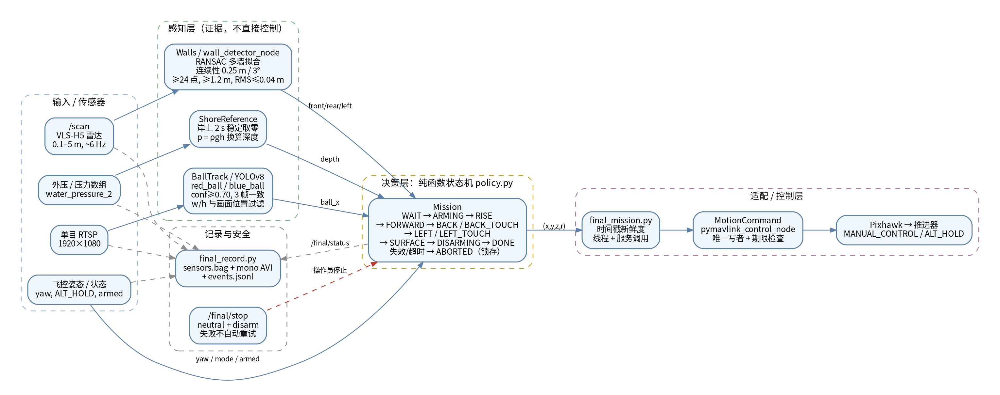

*图5-1 AUV 竞赛软件分层架构。感知层只提供证据，`policy.py` 是纯函数状态机，`final_mission.py` 是唯一控制适配层，`pymavlink_control_node` 是唯一飞控写者。*

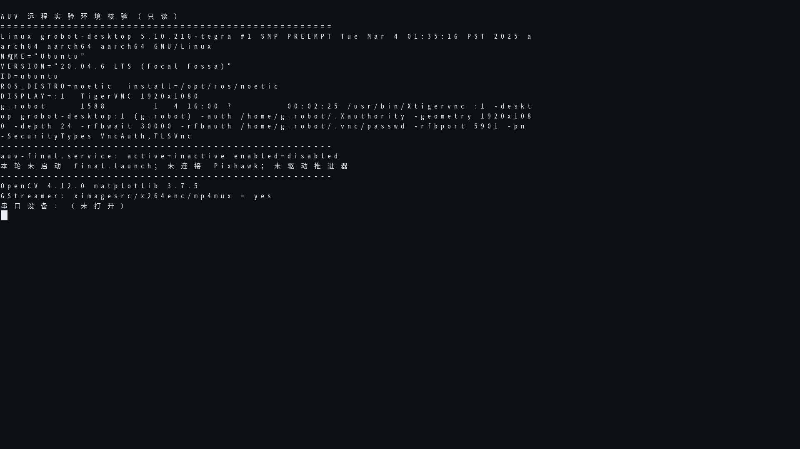

*图5-2 Jetson、Ubuntu 20.04、ROS Noetic、TigerVNC 与 `auv-final.service` 状态核验。*

### 5.1.2 与课程任务的技术映射

**表5-1 课程任务与 AUV 竞赛项目的对应关系**

| 课程中的知识点 | 课程任务中的体现 | AUV 项目中的体现 |
|---|---|---|
| 话题发布/订阅 | `task2` 的 `/task2/student_info` | `/scan`、`/auv_control/state`、`/final/status`、`/final/ball/detections` |
| 服务请求/响应 | `task2` 的 `/task2/query_student` | `MotionCommand`、`SetFlightMode`、`arm`、`neutral`、`read_surface_pressure` |
| 动态 TF2 | `task3` 的小乌龟跟随 | 雷达 `laser_frame`、飞控 `fc_attitude_ned_deg`、池壁坐标（本章只用只读 bag，未启用世界定位） |
| PID/控制律 | `task3` 双通道 PID | 航向 `HeadingGuard`、压力深度分段控制、视觉/墙距侧移脉冲 |
| 状态机 | `final_project` 抓放流程 | `policy.py` 的 `WAIT→ARMING→RISE→FORWARD→BACK→LEFT→SURFACE→DISARMING` |
| launch 组合 | `task1`/`task2`/`task3` 的 launch | `auv_final_competition/final.launch` 只组合飞控、雷达、记录、相机、检测、任务节点 |
| 录制与回放 | rosbag/截图 | `sensors.bag`、`mono_NNN.avi`、`events.jsonl`、`camera_frames.csv` |
| 安全边界 | 速度门控/空格取消 | 反馈新鲜度、倾角门限、深度边界、输出回执超时、锁存 `ABORTED`、neutral+disarm |

---

## 5.2 核心算法

### 5.2.1 分层架构与数据流

竞赛包把“感知”和“控制”分开，避免视觉/雷达直接驱动推进器：

```text
/scan ──► Walls(wall_detector) ─┐
water_pressure ──► ShoreReference ──► depth ──┐
fc_attitude ──► yaw/roll/pitch ───────────────┼──► Mission(policy.py) ──► (x,y,z,r)
camera ──► YOLOv8 ──► BallTrack ──► ball_x ───┘                               │
                                                                              ▼
                                              final_mission.py（时间戳/服务/线程）
                                                                              │
                                                                              ▼
                                       MotionCommand / pymavlink_control_node（唯一写者）
                                                                              │
                                                                              ▼
                                                            Pixhawk → 推进器/舵机
```

关键设计点：

1. **纯策略**：`policy.py` 不 import ROS、不读时钟、不写文件，只接收一个 `observation` 字典，返回四元组 `(x, y, z, r)`。这样可以用单元测试覆盖绝大多数边界。
2. **唯一写者**：`final_mission.py` 通过 `MotionCommand` 服务发送请求；其他菜单/入口不允许同时成为控制写者，避免两条链路抢推进器。
3. **证据不创造目标**：雷达/球检测缺失、歧义、过期时，`Walls`/`BallTrack` 返回空，不会用旧值或猜测值补一个目标。
4. **失败锁存**：压力、航向、飞控状态、记录器、输出回执任一失效，`ABORTED` 锁存，不自动重跑。
5. **记录独立**：`final_record.py` 把原始扫描、压力、姿态、控制请求、状态和球检测写入 `sensors.bag`，单目视频另写 `mono_NNN.avi`，事件写 `events.jsonl`。

工程结构截图见 `screenshots/02_project_structure.png`。`src` 下可见 17 个相关目录，其中 `auv_final_competition` 是本任务的最终入口；旧 `your_pkg`、`stereo_cam_ros` 等保留为历史/兼容入口，不在本章演示。

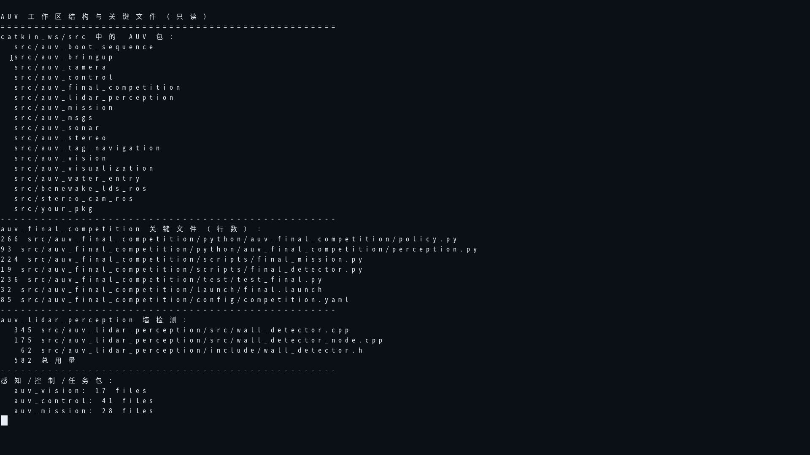

*图5-3 `catkin_ws/src` 的 AUV 相关包，以及 `auv_final_competition`/`auv_lidar_perception` 关键文件行数。*

### 5.2.2 任务状态机

`policy.py` 的核心是 `Mission`。状态集合与主要转移如下：

**表5-2 任务状态机**

| 状态 | 进入条件 | 主要输出 | 退出/异常 |
|---|---|---|---|
| `WAIT` | 上电、未解锁、记录/反馈可用 | `(0,0,500,0)` | 深度 ≥ `start_depth_m` 连续 `start_hold_s` → `ARMING` |
| `ARMING` | 已确认入水 | 等待飞控回执 | `ALT_HOLD+armed` 确认 → `RISE`；>12 s → `ABORTED` |
| `RISE` | 飞控已解锁 | `z=rise_z`（610） | `rise_s` 到时或接近浅水保护 → `FORWARD` |
| `FORWARD` | 上浮结束 | 前 5 s `x=forward_x`、`z=500`；之后深度闭环 + 视觉/墙距侧移 | 前墙 ≤ `front_stop_m` 或总时长到 → `BACK` |
| `BACK` | 前进结束 | `x=reverse_x`（-500）；后墙近时 `x=reverse_slow_x`（-150） | 后墙 ≤ `rear_near_m` → `BACK_TOUCH`；倒计时到 → `LEFT` |
| `BACK_TOUCH` | 后墙已近 | 轻靠 `x=-150` | `touch_s`（0.8 s）到 → `LEFT` |
| `LEFT` | 后退结束 | `y=left_y`（-300）；左墙近时 `y=left_slow_y`（-120） | 左墙 ≤ `left_near_m` → `LEFT_TOUCH`；倒计时到 → `SURFACE` |
| `LEFT_TOUCH` | 左墙已近 | 轻靠 `y=-120` | `touch_s` 到 → `SURFACE` |
| `SURFACE` | 返航动作结束 | 只发 `z=surface_z`（610），水平/转向清零 | 近水面压力稳定 → `DISARMING`；30 s 超时 → `ABORTED` |
| `DISARMING` | 水面窗口满足 | 回中、请求加锁 | 加锁确认 → `DONE`；8 s 超时 → `FINISH_FAILED` |
| `ABORTED`/`FINISH_FAILED`/`DONE` | 锁存 | `(0,0,500,0)` | 不再自行恢复 |

关键设计并不复杂，但每一条都对应一个真实失败模式：

- **`ZERO=(0,0,500,0)`**：在 Depth Hold 中，`z=500` 是中性升沉，不是“停桨”；`r` 是偏航速率请求，不是 MANUAL 的等效力度。
- **所有阶段都有时间上限**：前进 30 s 包含最初 5 s 和纠偏暂停；后退 30 s；左移 10 s；上浮 30 s；加锁 8 s。时间到就转段，不把“超时”写成“完成”。
- **不伪造成功**：前进/后退/左移结束只记录 `impact unconfirmed`、`rear contact unconfirmed`、`return unconfirmed`，不把近墙当成撞球/触壁。
- **状态转移即锁存**：`ABORTED` 后 `step()` 直接返回零，不会因为下一帧传感器恢复而继续。

`Mission.step()` 的主干（节选，来自 `src/auv_final_competition/python/auv_final_competition/policy.py`）：

```python
if self.state == 'WAIT':
    if o['armed']: self.abort('unexpected armed state before start'); return ZERO
    if depth >= c['heading_capture_depth_m'] and self.target is None: self.target = yaw
    if depth < c['start_depth_m']: self.deep_since = None; return ZERO
    if self.deep_since is None: self.deep_since = now
    if now - self.deep_since >= c['start_hold_s']:
        self.enter('ARMING', now, 'submerged continuously')
    return ZERO
...
if self.state == 'FORWARD' and (now - self.forward_started >= c['forward_total_s'] or
        o.get('front') is not None and o['front'] <= c['front_stop_m']):
    self.enter('BACK', now, 'front proximity or forward time; impact unconfirmed')
    return ZERO
...
if depth < c['min_depth_m'] or depth > c['max_depth_m']:
    if self.guard_since is None: self.guard_since = now
    if now - self.guard_since > c['depth_guard_timeout_s']:
        self.abort('depth boundary recovery timeout'); return ZERO
    return (0, 0, c['depth_down_z'] if depth < c['min_depth_m'] else c['depth_up_z'], 0)
```

### 5.2.3 压力深度、岸上零点与水面窗口

深度不是“飞控深度”，而是同一只外压传感器相对岸上零点的静水压换算：

```text
h = (p - p0) / (ρ · g)
ρ = 1000 kg/m³, g = 9.80665 m/s²
```

`ShoreReference` 只在**未解锁、岸上、压力新鲜且稳定**时取零：

- 至少 5 个样本，持续 `shore_zero_s=2.0 s`；
- 窗口压差 ≤ `shore_zero_spread_pa=150 Pa`；
- 若飞控能提供同一外压传感器的岸上读数，且与外部样本差 ≤ `surface_reference_tolerance_pa=200 Pa`，优先使用飞控候选值；
- 取零后冻结，入水后不再归零；重复时间戳不会刷新窗口；
- 水面判断 `SurfaceWindow` 要求：深度 ≤ `surface_max_depth_m=0.10 m`、至少 5 个**新鲜且时间戳递增**的样本、连续 `surface_stable_s=3.0 s`、窗口压差 ≤ `surface_spread_pa=100 Pa`（约 1 cm 水柱）。

桌面 `比赛参数.yaml` 的当前值和目标深度：

```text
ball_depth_m              = 0.30 m
strike_above_pressure_m   = 0.20 m
目标压力深度              = 0.50 m
depth_tolerance_m         = 0.04 m
min_depth_m / max_depth_m = 0.40 / 1.15 m
surface_max_depth_m       = 0.10 m
rise_z / neutral_z        = 610 / 500
depth_up_z / down_z       = 610 / 390
```

> **发现 1：当前桌面参数存在校验冲突。** `min_depth_m=0.40` 大于 `start_depth_m=0.30`，`Mission.validate()` 会抛出 `start depth`，导致最终任务无法通过参数校验。原始 `/home/g_robot/Desktop/比赛参数.yaml` 未被修改；本次演示在 `data/competition_demo.yaml` 生成了显式副本，仅把 `min_depth_m` 改为 `0.20`，并在演示脚本头部打印差异。历史比赛日志中的实际启动配置与当前桌面文件不完全一致（日志以 x=525 前进，桌面写 550），说明现场参数存在版本漂移。报告如实记录，不把副本结果冒充现场配置。

**表5-3 压力/深度关键参数**

| 参数 | 值 | 作用 |
|---|---:|---|
| `shore_zero_s` / `shore_zero_spread_pa` | 2.0 s / 150 Pa | 岸上取零的稳定性门槛 |
| `surface_reference_tolerance_pa` | 200 Pa | 飞控候选值与外部样本的一致性门槛 |
| `surface_stable_s` / `surface_spread_pa` | 3.0 s / 100 Pa | 近水面稳定窗口 |
| `surface_max_depth_m` | 0.10 m | 认为接近水面的深度上限 |
| `depth_tolerance_m` | 0.04 m | 目标深度死区 |
| `depth_guard_timeout_s` | 10 s | 深度边界纠正超时 |
| `min_depth_m` / `max_depth_m` | 0.40 / 1.15 m | 任务深度硬边界 |
| 目标深度 | 0.50 m | 球深度 0.30 + 撞击高度差 0.20 |

### 5.2.4 航向保持

`HeadingGuard` 使用飞控融合航向 `yaw` 与入水初期锁定的 `target`：

```python
error = wrap(target - yaw)                  # wrap 到 (-180, 180]
remaining = wrap(error - (-1.0))            # 停止误差 -1°
r = clamp(kp * abs(remaining), 175, 275)    # 限幅后的偏航速率请求
```

- 触发阈值 `heading_trigger_deg=10°`；小于 10° 不修正；
- 停止误差 `heading_stop_error_deg=-1°`，到达或跨过就停；
- `heading_kp=12`，`r` 限幅 175–275；这里的 `r` 是 Depth Hold 的偏航速率输入，不是 MANUAL 菜单 21 的 275；
- 单次修正上限 `heading_timeout_s=30 s`；修正结束后 `heading_settle_s=0.3 s` 再恢复平移；
- 修正期间只发 `(0,0,z,r)`，不允许边转边前进。

真实日志中的失败案例 `31be0b02` 正是这条边界：目标航向约 70°，误差在修正过程中始终没有回到 -1°，30 s 后 `RuntimeError: heading correction timeout`，`final_mission.py` 捕获并锁存 `ABORTED`。这说明“有航向闭环”不等于“航向一定能收敛”；水下推力、初始角速度和飞控速率限幅都会让它失败。详见 `figures/heading_abort_31be0b02.png`。

### 5.2.5 雷达墙检测

雷达是 VLS-H5，量程按 0.1–5.0 m 使用。C++ 节点 `wall_detector_node` 对每圈 `/scan` 做多墙 RANSAC：

1. 把 `ranges` 转成 `laser_frame` 下的二维点；
2. 用 300 次 RANSAC 采样找支持点最多的直线（inlier 阈值 0.03 m）；
3. 按点距 0.25 m 或扫描角距 3° 分段，段内再最小二乘拟合；
4. 要求每段 ≥24 点、可见长度 ≥1.2 m、RMS ≤0.04 m；
5. 移除已接受墙的支持点，继续找下一面，最多 8 面；
6. 输出 `/detected_walls`（`auv_msgs/WallArray`）、`/detected_wall_marker`（RViz 绿色线段）和兼容的单墙话题。

Python 侧 `Walls` 在 `policy.py` 之外再做一层“证据确认”：

- 用 `laser_yaw_deg=180°` 补偿雷达反向安装：原始雷达 `-X` 对应机体前方；
- 用飞控相对初始航向的旋转把墙线关联到机体前/后/左；
- 每侧距离取多段均值，同侧多段差 >0.20 m 视为冲突；
- 连续 `wall_confirm_frames=3` 帧一致才采信；
- 超时 `wall_timeout_s=0.5 s` 清空；
- 近墙阶段先减速再轻靠；左距纠偏有 0.25 m 触发、0.10 m 释放、0.25 s 脉冲、0.40 s 休息、总预算 3 s。

真实水下 bag（`field/19700101T000105Z_217c3dec/sensors.bag`）回放时，当前 C++ 节点在 140 帧实时输出中稳定给出 1–3 面墙。最佳帧的 3 面墙数据：

**表5-4 真实水下雷达帧的三面墙（`figures/wall_detection_frame.png`）**

| 墙 | 法向方向 / ° | 垂直距离 / m | 可见长度 / m | 支持点 | RMS / m |
|---|---:|---:|---:|---:|---:|
| 1 | -148.7 | 0.459 | 1.324 | 50 | 0.0073 |
| 2 | 141.6 | 1.054 | 2.141 | 41 | 0.0079 |
| 3 | -62.8 | 2.445 | 1.354 | 29 | 0.0130 |

> 表中方向是**原始 `laser_frame`** 的法向角，不是机体前/后/左；`laser_yaw_deg=180°` 的安装补偿在策略层只做一次，原始 `/scan`、bag 和 RViz 的 `laser_frame` 不再重复旋转。真实部署前必须用池壁/卷尺复核安装角和雷达平移外参。

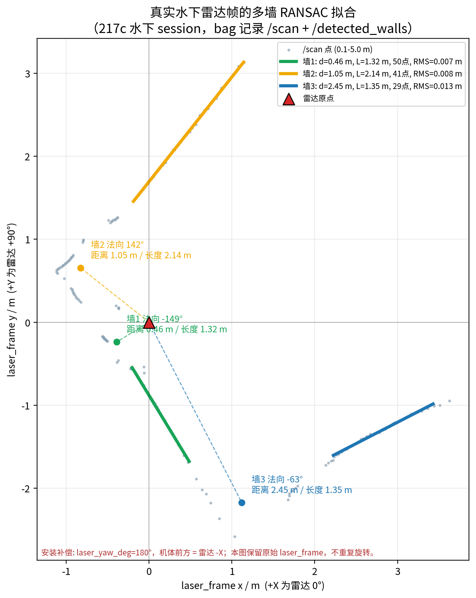

*图5-4 217c 水下 session 的真实 `/scan` 与 `/detected_walls`，三面墙 0.46/1.05/2.45 m，RMS 7–13 mm。*

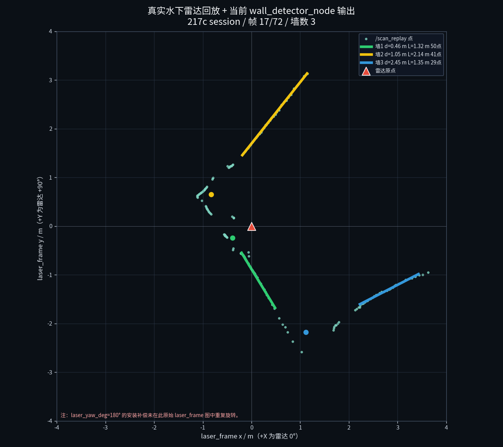

*图5-5 运行中的 `wall_detector_node` 对真实 `/scan_replay` 的输出；绿/黄/蓝为三面墙，红三角为雷达原点。*

#### 关于 RViz 的说明

本次在 TigerVNC 的 RViz 1.14 中直接显示 1970 时间戳 bag 的 `/scan` 时，`Lidar scan /scan` 持续显示 `Status: Error`、`Global Status: Error`，只能看到网格，看不到点云/墙线。尝试过：

- `/use_sim_time=true` + `rosbag play --clock`；
- 发布 `map→laser_frame` 静态 TF；
- 增加 `/scan_replay` 用当前墙钟重新打时间戳；
- 把 fixed frame 从 `laser_frame` 改为 `map`。

上述组合仍未消除该 RViz 的 LaserScan 显示错误。为了不把时间耗在显示层，最终演示改为**直接用当前节点的 `/detected_walls` 输出做自绘顶视图动画**：`wall_capture.py` 记录 `/scan_replay` 与 `/detected_walls` 的配对帧，`make_wall_animation.py` 渲染 `videos/02_lidar_wall_detection.mp4`。数据仍来自当前 C++ 节点的实时输出，不是用旧图或合成墙替代；RViz 的限制在报告中如实说明。

### 5.2.6 球检测与 BallTrack

最终任务的视觉只做“横向微调”，不做单目测距：

- 模型：YOLOv8；正式 `final.launch` 默认 `legacy_ball.pt`（类别 red_ball/blue_ball）；本次演示使用项目中同样存在的 `251016_ball_01_model_01_best.pt`（类别 red_ball/blue_ball），因为它在真实水下蓝球上检出更稳定；
- 输入：RTSP 单目 1920×1080，检测节点把中心点和宽高统一归一化到 [0,1]；
- 正式阈值 `vision_confidence=0.70`；本次演示为了展示链路使用 0.35，并在图/日志中明确标注；
- `BallTrack` 的硬门控（来自 `perception.py`）：
  - 类别必须是 `target_color + '_ball'`；
  - 置信度 ≥ 阈值；
  - `0.02 < w < 0.8`、`0.02 < h < 0.8`、`0.5 < w/h < 2.0`；
  - 画面位置 `x,y ∈ [0,1]`；
  - 同一帧只能有一个合格候选；
  - 与上一帧的 `x`、`y` 差 <0.12 才算“连续”，连续 `vision_confirm_frames=3` 帧才输出；
  - `vision_timeout_s=0.5 s` 过期清空；
- 策略侧只使用 `ball_x`：误差 `ball_x - vision_aim_x`；超过 `vision_deadband=0.08` 才发 ±100 的横向脉冲；每次脉冲 0.25 s、休息 0.40 s，总预算 2 s；左墙可信且目标更外侧时，视觉不得把机器人推出走廊；
- 不使用 `ball_y` 估距离，不旋转搜球，不按画面上下追球。

真实水下蓝球片段（`field/19710101...` 的 `camera.avi` 左目，141.5–147.0 s，5 fps）：

- YOLO 在 16 条检测消息上给出（片段循环回放，含重复帧） `blue_ball`，置信度 0.38–0.84；
- 归一化宽高比 `w/h` 为 0.306–0.425，**全部低于 0.5**；
- 因此 `BallTrack` 的 `0.5 < w/h < 2.0` 条件将 16 个框全部拒绝，`count=0`、`ball_x=None`、`trim=0`；
- 作为对照，用项目真实的 `BallTrack` 类输入 3 帧 `w=h=0.10` 的受控框，`count` 依次 1/2/3，第 3 帧给出 `ball_x=0.700`，误差 +0.200 → `+100` 侧移；
- 用 16:9 真实框 `w=0.129,h=0.360` 重复三帧，`count` 始终 0，`w/h=0.358 < 0.5` 被拒绝。

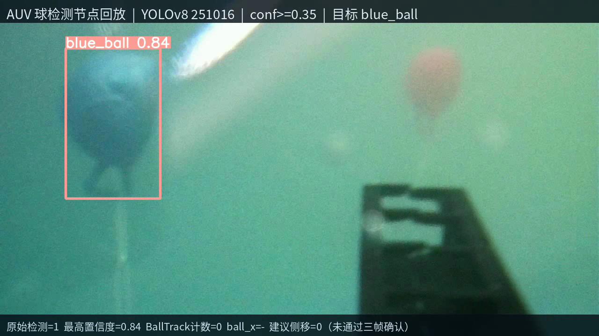

*图5-6 `auv_vision/object_detection_node.py` 在真实水下蓝球上的检测结果（`blue_ball 0.84`）；画面右上还有一颗未检出的红球，说明正式 `target_color=red` 的现场模型/阈值仍需调优。*

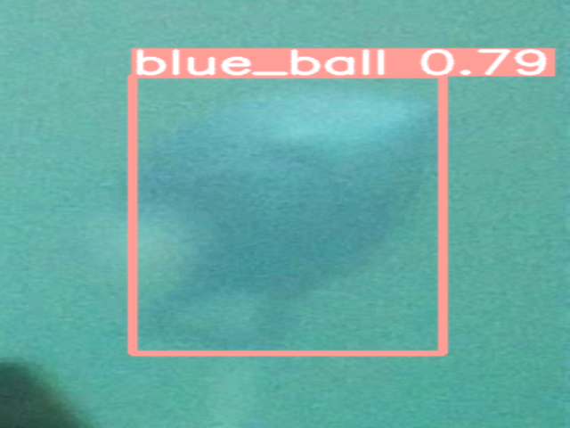

*图5-7 检测框放大；框的高度明显大于宽度，原因是 16:9 图像中的球体被归一化到不同尺度。*

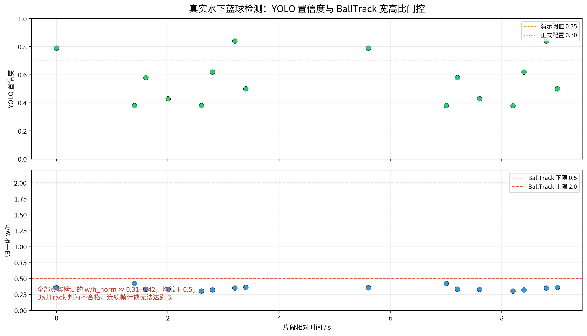

*图5-8 16 次真实检测的置信度与归一化宽高比。置信度大多超过演示阈值 0.35，但宽高比全部低于 BallTrack 的 0.5 下限，因此连续帧计数无法达到 3。*

#### 发现 2：BallTrack 的宽高比门控不是像素宽高比

`perception.py` 用的是**归一化**坐标：

```python
.5 < b['w'] / b['h'] < 2.
```
其中 `b['w'] = bbox_width / image_width`，`b['h'] = bbox_height / image_height`。在 16:9 图像中，这等价于
`(w_px / 1920) / (h_px / 1080) = 0.5625 * (w_px / h_px)`。一个像素上近似正方形、但归一化后高宽比为 0.56 的球框，会被错误地压到 0.5 以下。本次真实框的像素宽高比约 0.64，归一化后 0.36，正好被拒绝。

这不只是“演示没成功”：它直接解释了最终比赛日志 `/final/status` 中 `ball_x` 始终为空、视觉侧移始终为 0 的原因之一。正式阈值 0.70 又会进一步过滤掉 0.38/0.58/0.43 等低置信度帧。建议：

1. 宽高比检查改用像素宽高比 `w_px/h_px`，或改为可配置的宽高比范围；
2. 对 16:9 训练/验证数据重新评估 0.5–2.0 的范围；
3. 如果目标球是竖直浮标，应把“球”和“浮标/系绳”分开标注，避免检测框被拉长；
4. 保留“置信度 + 三帧一致 + 唯一候选”的其余门控，不要为了通过而一次性放宽所有阈值。

### 5.2.7 安全边界与记录

`final_mission.py` 不是“另一个控制器”，而是策略与飞控之间的适配层：

- **唯一写者**：`MotionCommand` 只允许 `final_mission` 调用；菜单/手动入口不能同时写；
- **时间戳新鲜度**：`feedback_timeout_s=0.75 s`、`attitude_timeout_s=0.30 s`；过期即 `feedback_ok=False`，策略 `ABORTED`；
- **输出回执**：`LatestCommandTransport` 超过 1 s 没有回执即中止；`ABORTED/DISARMING/FINISH_FAILED/DONE` 不再接受迟到的运动请求；
- **倾角门限**：`max_tilt_deg=20°`；超过即中止，避免把三维姿态问题当成平面问题；
- **深度边界**：低于 `min_depth_m` 或高于 `max_depth_m` 时暂停水平动作，10 s 内纠正不回来就 `ABORTED`；
- **记录门控**：`record_ok` 为假时，非 `WAIT` 状态直接中止；比赛记录器失败不会被当成“继续跑”；
- **收尾**：`SURFACE` 稳定后请求 neutral + disarm；8 s 内没有“已连接、已加锁”的新鲜反馈则 `FINISH_FAILED`，保留连接和记录，不伪装成 `DONE`。

记录器 `final_record.py` 每次生成独立目录：

- `sensors.bag`：原始 LaserScan、外压、压力数组、姿态、飞控模式/解锁、RC、推进器 PWM、实际 MANUAL_CONTROL、任务状态/请求、球检测；
- `mono_NNN.avi`：单目视频分段；
- `camera_frames.csv`：逐帧 ROS 时间、单调时钟、帧号、段号、尺寸；
- `events.jsonl`：状态、请求、检测和决策的逐条事件；
- `config.json` / `capture_end.json`：参数快照和正常关闭清单。

---

## 5.3 实验展示与结果

### 5.3.1 环境核验与纯策略测试

先确认“没有硬件在跑”：

- `auv-final.service` 为 `inactive/disabled`；
- 没有 `rosmaster`、`final_mission`、`pymavlink`、Gazebo 进程；
- `/dev/ttyACM*`、`/dev/ttyUSB*` 未打开；
- 本次只用自定义 ROS master（11321/11322）和 bag/视频回放；
- 所有辅助脚本、截图、视频、日志均在 `/home/g_robot/show_xjy/`。

**图5-2** 已给出环境截图；`screenshots/02_project_structure.png` 给出工程结构。

纯策略测试使用项目自带 `test_final.py`，覆盖状态机、深度、航向、墙/球门控、传输门控：

- 测试文件 236 行；
- 结果 **35/35 通过**，总耗时约 0.99 s；
- 分类：Policy 14、Surface 8、HeadingAndPressure 5、Perception 6、Transport 2；
- 测试不加载 Gazebo、不连接飞控、不打开串口，只验证纯函数/纯策略/感知门控。

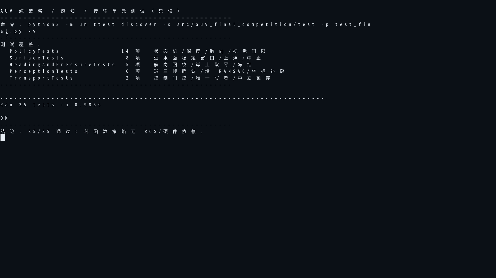

*图5-9 `test_final.py` 的 35 项测试全部通过；覆盖范围仅限纯策略/感知/传输，不等价于实船验收。*

### 5.3.2 任务状态机正常流程演示

为了在终端完整展示状态、深度、航向、墙距、球和四轴请求，`tools/mission_demo.py` 直接 import 项目的 `Mission`/`ShoreReference`，用确定性的观察序列驱动，不连接 ROS 或飞控。演示副本 `data/competition_demo.yaml` 只把 `min_depth_m` 从 0.40 调到 0.20（见“发现 1”），其余保持桌面参数。

演示的关键行：

**表5-5 状态机正常流程的关键转移（演示输入，非实船）**

| 时间/s | 状态 | 观察 | 请求 `(x,y,z,r)` | 说明 |
|---:|---|---|---|---|
| 0.00 | WAIT | depth 0.02 | (0,0,500,0) | 岸上待命，未解锁 |
| 2.00 | WAIT | depth 0.18 | (0,0,500,0) | 捕获初始航向 target=20° |
| 6.10 | ARMING | depth 0.60 | (0,0,500,0) | 连续 3 s 入水判定 |
| 6.30 | RISE | depth 0.58 | (0,0,610,0) | 飞控回执 ALT_HOLD+armed |
| 9.40 | FORWARD | depth 0.55 | (550,0,500,0) | rise 3 s 结束 |
| 14.40 | FORWARD | depth 0.62 | (550,0,610,0) | 前进 5 s 后启用深度修正 |
| 16.00 | FORWARD | ball_x 0.80 | (550,100,500,0) | 视觉误差 0.30 → +100 脉冲 |
| 20.00 | BACK | front 0.62 | (0,0,500,0) | 前墙 ≤0.65 m；撞球未确认 |
| 22.50 | BACK_TOUCH | rear 0.75 | (-150,0,500,0) | 后墙 ≤0.80 m |
| 23.30 | LEFT | rear 0.75 | (0,0,500,0) | 轻靠 0.8 s 结束 |
| 24.80 | LEFT_TOUCH | left 0.50 | (0,-120,500,0) | 左墙 ≤0.55 m |
| 25.60 | SURFACE | left 0.50 | (0,0,500,0) | 本周期先回中 |
| 25.70 | SURFACE | depth 0.05 | (0,0,610,0) | 只发上浮 |
| 28.70 | DISARMING | depth 0.05 | (0,0,500,0) | 3 s 稳定窗口满足 |

注意 `SURFACE` 的进入周期返回零（先回中），下一个 50 ms 周期才发 `z=610`；这是状态机“进入动作”和“持续动作”分开的实现细节，演示日志中如实打印。

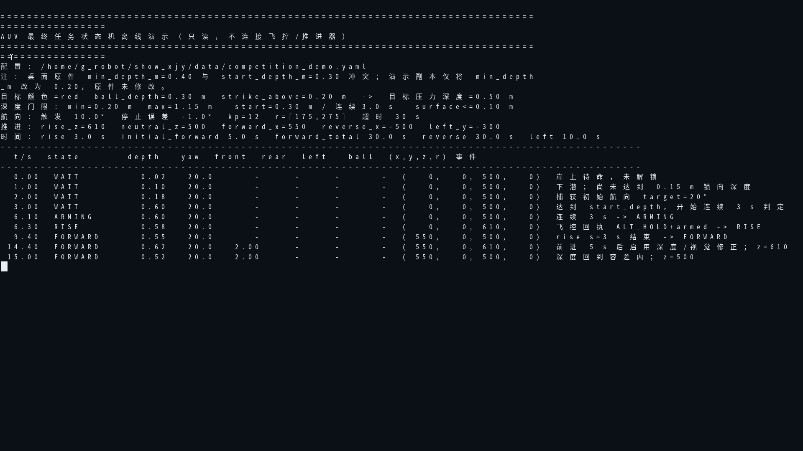

*图5-10 岸上待命、入水判定、RISE、FORWARD、视觉侧移与前墙转后退。*

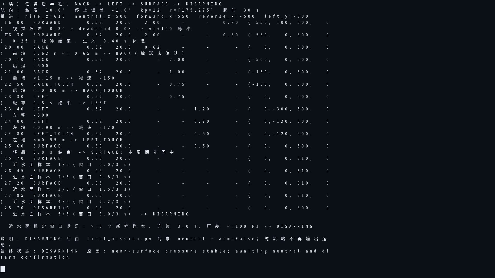

*图5-11 后墙轻靠、左移、SURFACE、近水面稳定窗口与 DISARMING。*

终端录制：`videos/01_mission_state_machine.mp4`（28 s，1920×1080，10 fps）。视频中逐行打印状态机表，便于观察每个状态对应的请求变化。

### 5.3.3 真实比赛事件回放

对 `recordings/final/19700101T000103Z_981ac8a2` 的 `/final/status` 事件做解析，得到：

- 样本 1918 条，会话时长 99.2 s；
- 深度范围 -0.001–0.838 m；
- 状态转换：WAIT 0.00 → ARMING 30.10 → RISE 31.68 → FORWARD 34.70 → BACK 64.70 → LEFT 94.75；
- 最终状态 `LEFT`，原因 `reverse time limit; rear contact unconfirmed`；
- `ball_x` 有效样本 0，墙距 `front/rear/left` 有效样本 0（该会话的 `/final/status` 中没有可用墙距）；
- 请求中 x 实际为 **525**（日志），桌面配置写 550，说明现场版本与桌面文件有差异；
- 前进段 30 s 到时后转 BACK；后退段 30 s 到时后转 LEFT；没有进入 SURFACE，因此不能把这次会话写成“完整返航/出水成功”。

**表5-6 真实会话 981ac8a2 的状态转换**

| 时间/s | 状态 | 原因 |
|---:|---|---|
| 0.00 | WAIT | shore initialization |
| 30.10 | ARMING | submerged continuously |
| 31.68 | RISE | ALT_HOLD and armed confirmed |
| 34.70 | FORWARD | initial rise ended |
| 64.70 | BACK | front proximity or forward time; impact unconfirmed |
| 94.75 | LEFT | reverse time limit; rear contact unconfirmed |

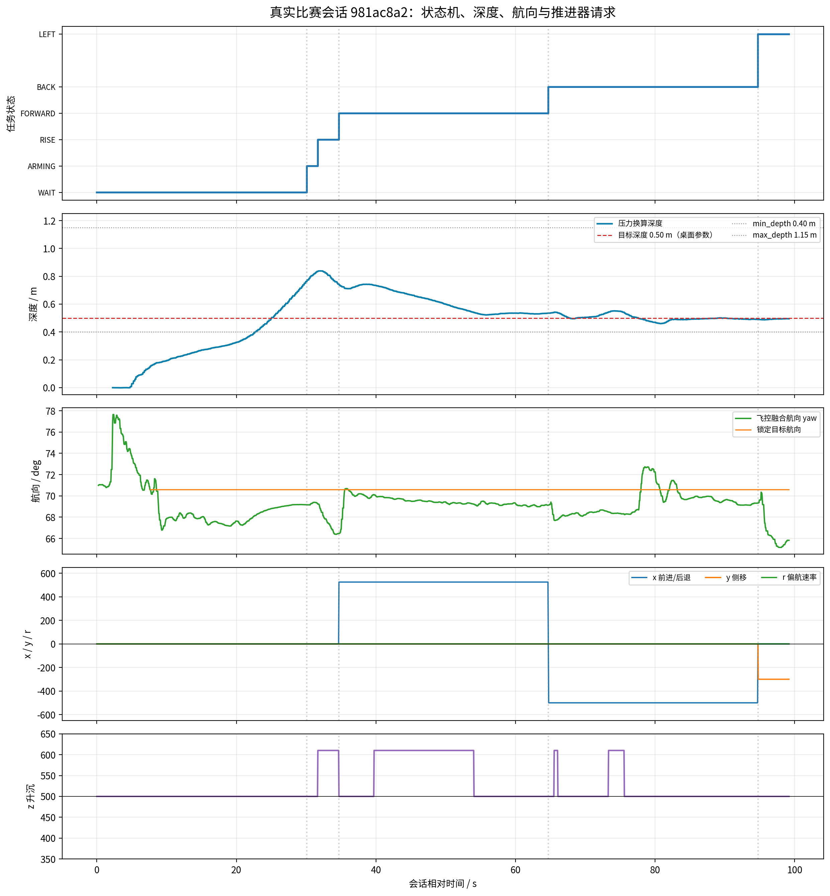

*图5-12 真实 `/final/status` 回放。深度目标 0.50 m；前进/后退/左移均有阶段上限；最终在 LEFT 结束，没有 SURFACE/DONE。*

另一个真实会话 `31be0b02`：

- 1082 条状态样本，57.4 s；深度 0.000–0.862 m；
- WAIT 0.00 → ARMING 16.91 → RISE 17.30 → FORWARD 20.30 → **ABORTED 47.32**；
- 原因 `heading correction timeout`；
- 从 RISE 起 r 请求为 -158、-152、-146…，是航向误差经过 kp/限幅后的结果；30 s 内误差没有回到 -1°，按设计锁存中止；
- 中止后 `step()` 返回零，不再自动重试，也不伪装成完成。

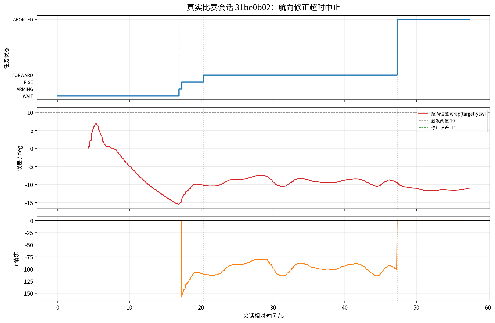

*图5-13 航向误差与 r 请求；误差始终没有回到 -1°，30 s 上限触发 ABORTED。*

### 5.3.4 雷达墙检测实验

实验过程：

1. 从 `recordings/field/19700101T000105Z_217c3dec/sensors.bag`（864.9 s，5201 个 `/scan`）中选取包含三面墙的相对 850–862 s 窗口；
2. 启动自定义 master 11321；
3. 用 `scan_republish.py` 把原始 `/scan` 重新打上当前墙钟时间戳，发布 `/scan_replay`（解决旧 bag 时间戳与 RViz/消息过滤的兼容问题）；
4. 运行项目当前 `wall_detector_node`，输入 `/scan_replay`，参数 24 点/1.2 m/3 cm/300 次 RANSAC；
5. 用 `wall_capture.py` 记录 140 对 `/scan_replay`+`/detected_walls`；
6. 用 `make_wall_animation.py` 生成顶视图动画和最佳帧截图。

实测：

- `/scan_replay` 约 6.11 Hz；
- 节点日志中稳定出现 1–3 面墙；三面墙最佳帧数据见表5-4；
- 最佳帧：墙1 0.459 m/50点/RMS 0.0073；墙2 1.054 m/41点/RMS 0.0079；墙3 2.445 m/29点/RMS 0.0130；
- 节点日志摘录（原始时间戳为 ROS 墙钟，不是 1970 bag 时间）：

```text
[INFO] [2679.883481792]: [wall_detector_node] Detected 3 wall(s). Strongest: direction=-148.7 deg,
       distance=0.46 m, length=1.32 m, points=50, rms=0.007 m
[INFO] [2682.027620256]: [wall_detector_node] Detected 2 wall(s). Strongest: direction=-143.6 deg,
       distance=0.45 m, length=1.18 m, points=63, rms=0.008 m
[INFO] [2683.177944512]: [wall_detector_node] Detected 2 wall(s). Strongest: direction=153.1 deg,
       distance=1.00 m, length=2.00 m, points=31, rms=0.006 m
```


*图5-14 真实 `/scan_replay` 上的 3 面墙；绿/黄/蓝为墙线，红三角为雷达原点，图注明确保留原始 laser_frame。*

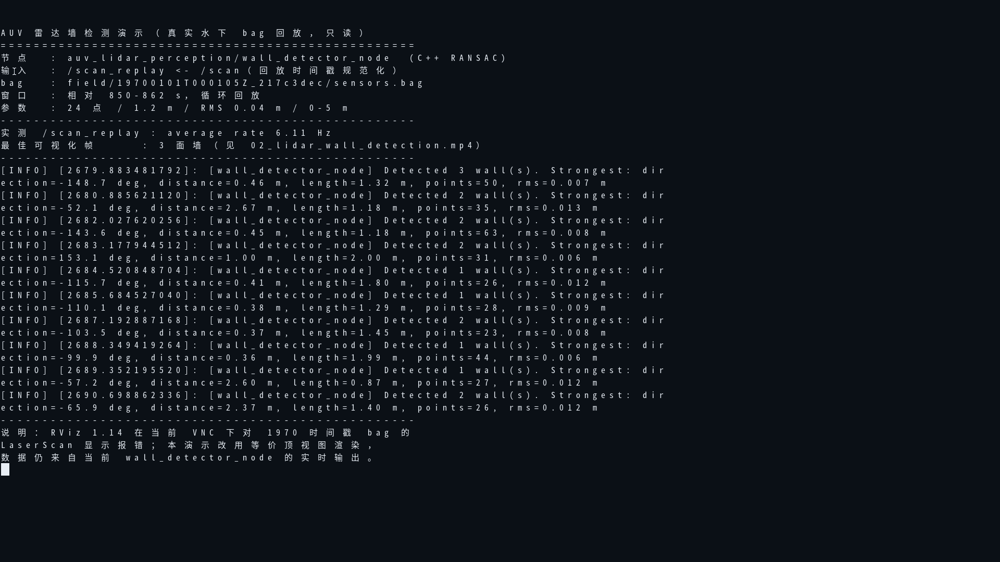

*图5-15 当前节点连续输出的 1–3 面墙日志；平均 6.11 Hz，最佳帧为 3 面墙。*

视频：`videos/02_lidar_wall_detection.mp4`（14.4 s，1296×1152，10 fps）。

### 5.3.5 球检测与门控实验

实验过程：

1. 从 `recordings/field/19700101T000105Z_217c3dec/camera.avi` 取左目 141.5–147.0 s，降采样到 5 fps，得到 `data/ball_blue_142_147_5fps.mp4`（1280×720，28 帧，5.6 s）；
2. 启动 master 11322；
3. `video_publisher.py` 把视频帧以 `bgr8` 发布到 `/demo/camera/image_raw`；
4. 运行项目真实的 `auv_vision/object_detection_node.py`，模型 `251016_ball_01_model_01_best.pt`，conf 0.35，device 0；
5. `ball_track_monitor.py` 订阅检测结果，按 `final_mission.py` 相同的归一化方式喂给项目真实 `BallTrack`；
6. `capture_annotated.py` 录制带中文状态横幅的标注视频，并保存最佳帧/放大图。

结果：

- 16 条真实检测消息（循环回放，含重复帧），`blue_ball` 置信度 0.38–0.84；
- 归一化 `w/h` 0.306–0.425，全部低于 0.5，`BallTrack` 全部拒绝；
- `count=0`、`ball_x=-`、`trim=0`；
- 受控 3 帧 `w=h=0.1`：`count=1/2/3`，第 3 帧 `ball_x=0.700`，误差 +0.200 → `+100`；
- 16:9 真实框 `w=0.129,h=0.360`：`w/h=0.358`，三帧仍为 0；
- 画面右上还有一颗红球，当前 0.35 阈值未检出；正式 `target_color=red` 时需要现场重新确认模型、阈值和画面构图；
- 最终比赛日志 `ball_x` 全空，与上述门控结果一致，不能把“模型没检出/门控拒绝”写成“视觉已经工作”。

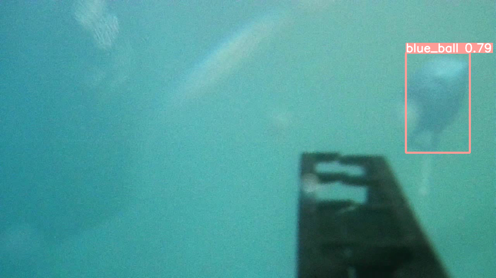

*图5-16 真实水下蓝球原始 YOLO 标注帧（`blue_ball 0.84`，不带演示横幅）；同一片段的带横幅视频帧见图5-6。*

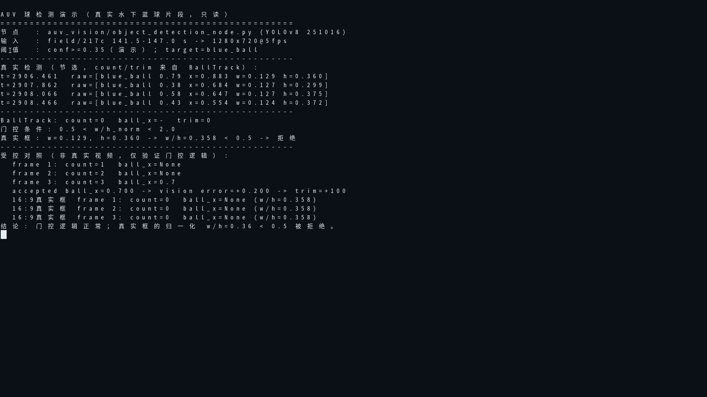

*图5-17 真实检测节选、BallTrack 计数、宽高比拒绝原因，以及受控三帧输入的对照结果。*

视频：`videos/03_ball_detection_annotated.mp4`（12.0 s，1280×720，5 fps）。

### 5.3.6 真实比赛水下录像

从 `981ac8a2/mono_001.avi` 取 30–60 s，得到 1920×1080、10 fps 的 `videos/04_competition_pool.mp4`。该段是 AUV 前视单目在水下的画面，画面底部可见 AUV 前部结构，水体呈蓝绿色；视频左上角的 `2026-10-16 02:29:39` 是相机/系统叠加时间，Jetson 系统时钟未校正，不能当作真实比赛日期。

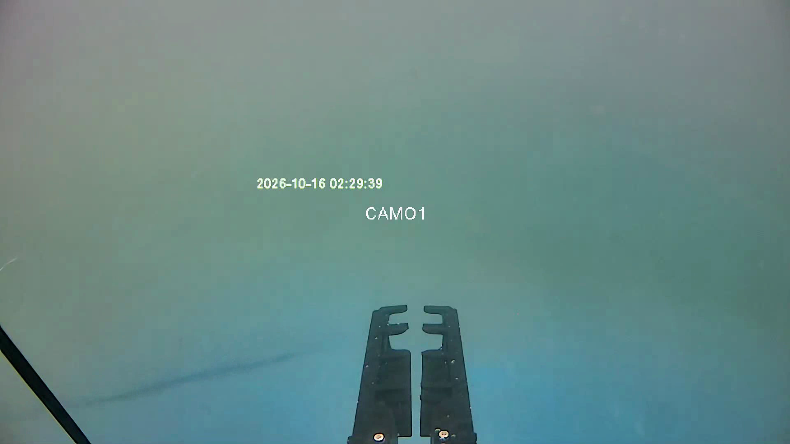

*图5-18 真实比赛单目水下段（30–60 s 中的一帧）；底部为 AUV 前部结构，不是合成场景。*

### 5.3.7 结果汇总

**表5-7 AUV 进阶实践结果汇总**

| 项目 | 输入/数据 | 工具/节点 | 结果 | 证据 |
|---|---|---|---|---|
| 纯策略测试 | `test_final.py` | Python unittest | 35/35 通过，约 0.99 s | `logs/unit_test_final.log`、图5-9 |
| 状态机正常流程 | 确定性观察序列 | `Mission`/`ShoreReference` | 28.7 s 到 DISARMING | 图5-10/5-11、`videos/01_...mp4` |
| 真实会话 981 | `events.jsonl` | `analyze_sessions.py` | 99.2 s，最终 LEFT；无 ball_x/墙距 | 图5-12、`data/session_981ac8a2.csv` |
| 真实会话 31be | `events.jsonl` | 同上 | 57.4 s，航向超时 ABORTED | 图5-13 |
| 雷达墙检测 | 217c `sensors.bag` | `wall_detector_node` + `/scan_replay` | 1–3 面墙；最佳 0.46/1.05/2.45 m | 图5-14/5-15、`videos/02...mp4` |
| 球检测 | 217c 左目 141.5–147 s | `object_detection_node.py` + `BallTrack` | 16 次检测，0 通过宽高比门控 | 图5-16/5-17、`videos/03...mp4` |
| 真实比赛画面 | 981ac8a2 30–60 s | 片段截取 | 水下前视 30 s | 图5-18、`videos/04...mp4` |

---

## 5.4 讨论与归纳

### 5.4.1 与课程任务的差异

课程任务的“正确”通常可以由 Gazebo 的模型状态、RViz 的 TF 和终端的成功字符串证明；AUV 的“正确”必须由传感器证据和时间共同证明。本章最值得带回课程的三点是：

1. **纯函数策略的价值**：`Mission` 不依赖 ROS，35 项测试在 1 s 内完成；真实日志可以被解析成同一组状态/请求，便于离线复盘。课程里的抓放状态机也可以用同样方式拆出纯策略。
2. **证据与执行分离**：雷达/球只提供证据，策略只输出四元组，适配层只做时间戳/服务/线程。任何“视觉直接发速度”的捷径都会让失败无法定位。
3. **安全的默认值是“停”**：传感器过期、记录失败、输出回执超时、倾角超限、深度边界纠正超时都锁存中止；宁可本次不得分，也不让机器人带着错误状态继续跑。

### 5.4.2 发现的问题与改进建议

**表5-8 本次实验发现的问题**

| 编号 | 现象 | 证据 | 影响 | 建议 |
|---|---|---|---|---|
| 1 | 桌面参数 `min_depth_m=0.40` > `start_depth_m=0.30` | `Mission.validate()` 抛 `start depth` | 按当前桌面文件直接启动会被 `Mission.validate()` 拒绝 | 统一参数来源；启动前跑 `validate()`；把现场值写入版本库/检查清单 |
| 2 | `BallTrack` 用归一化 `w/h` 做 0.5–2.0 门控 | 16 次真实检测全部 0.306–0.425 | 视觉侧移不触发，`ball_x` 长期为空 | 改为像素宽高比或可配置范围；用 16:9 数据回归 |
| 3 | 正式阈值 0.70 与演示阈值 0.35 差异大 | 真实检测 0.38/0.58/0.43 等低于 0.70 | 即使修宽高比，部分帧仍会被拒 | 现场按画质/模型重新标定阈值，保留三帧一致 |
| 4 | 无墙距时仍按定时路线走 | 981 会话 front/rear/left 有效样本 0 | 前进/后退/左移只能靠时间，无法证明触壁 | 把雷达/安装角/外参纳入赛前检查；记录墙距有效性 |
| 5 | 现场 x=525 与桌面 550 不一致 | 981 日志 vs `比赛参数.yaml` | 复盘和复现困难 | 冻结参数版本；日志记录完整配置快照 |
| 6 | RViz 1.14 对旧时间戳 bag 的 LaserScan 显示错误 | RViz `Status: Error`，只有网格 | 无法直接用 RViz 录屏 | 回放时重打时间戳/设置 sim time；或使用自绘可视化（本次采用） |
| 7 | 模型/相机画面存在未检出的红球 | 图5-16 右上红球 | 正式 red 目标可能漏检 | 现场采集红球数据、检查曝光/距离/阈值，不要只用蓝球验证 |

### 5.4.3 局限

- 本次没有启动推进器、没有下水、没有连接 Pixhawk；所有“运动”是真实日志/离线策略/bag 回放，不是本次现场控制结果。
- 35 项测试只覆盖纯策略、感知门控和传输门控；不等于飞控时序、推进器推力、机械安装、水下通信的验收。
- 雷达墙检测只在一个 217c 水下 session 上回放；没有做池壁几何、安装角、外参、浑浊度和弯墙的系统性标定。
- 球检测只在一个 141.5–147 s 片段上回放；模型/阈值/相机曝光没有做现场 sweep。
- 真实比赛日志中的 981 会话没有进入 SURFACE/DONE；31be 会话中止；不能写成“完整比赛成功”。
- 当前桌面参数与历史日志存在版本差异；报告已按“发现 1/5”标注，不把副本参数冒充现场配置。

### 5.4.4 后续工作

1. 修复桌面参数冲突，把 `validate()` 作为开机/启动前的硬检查；
2. 用 16:9 真实数据修正 `BallTrack` 宽高比门控，并回归 35 项测试；
3. 把雷达墙距接入 `/final/status` 的有效性检查，明确“无墙距时是否允许定时直行”；
4. 在真实水池做雷达安装角/外参、压力零点、航向 PID、视觉阈值和推进器死区的系统标定；
5. 给最终任务增加“离线回放 + 数据核对”脚本，比赛后自动生成状态/深度/航向/请求时间线；
6. 若需要答辩展示，可把 `videos/01–04` 与 `screenshots/01–14` 作为电子附件，正文只放关键帧。

---

## 5.5 与 Word 报告的整合建议

### 5.5.1 章节位置

建议把本章作为**第五章“进阶实践：AUV 自主水下机器人竞赛项目”**，插在原“四、拓展任务”之后、原“五、课程心得”之前；原“课程心得”顺延为第六章，附录不变。若学校模板要求固定章节数，可把本章压缩为“第四章的 4.5 进阶实践”，但会失去算法细节，不推荐。

### 5.5.2 图表编号

原报告已用到图49、表14；建议本章从**图50、表15**续排（或使用 Word 的章编号“图5-1”）。本文件中的图5-1…图5-18、表5-1…表5-8是章节内编号，复制到 Word 时可统一替换为图50…/表15…。对应关系如下：

**表5-9 建议插入的图与素材（按章节顺序续排）**

| 建议图号 | 本章图号 | 图题 | 文件 | 章节 |
|---|---|---|---|---|
| 图50 | 图5-1 | AUV 竞赛软件分层架构 | `figures/architecture.png` | 5.2.1 |
| 图51 | 图5-2 | 实验环境与只读核验 | `screenshots/01_environment.png` | 5.3.1 |
| 图52 | 图5-3 | 工程结构与关键文件 | `screenshots/02_project_structure.png` | 5.2.1 |
| 图53 | 图5-4 | 真实雷达三面墙拟合 | `figures/wall_detection_frame.png` | 5.3.4 |
| 图54 | 图5-5 | 当前墙检测节点实时输出 | `screenshots/08_lidar_wall_detection.png` | 5.3.4 |
| 图55 | 图5-6 | 真实蓝球带横幅检测帧 | `screenshots/10_ball_detection_video.png` | 5.2.6 |
| 图56 | 图5-7 | 蓝球检测放大 | `screenshots/12_ball_detection_zoom.png` | 5.2.6 |
| 图57 | 图5-8 | 球检测门控诊断 | `figures/ball_gate_diagnostic.png` | 5.2.6 |
| 图58 | 图5-9 | 35 项纯策略测试 | `screenshots/04_unit_tests.png` | 5.3.1 |
| 图59 | 图5-10 | 状态机正常流程（前半程） | `screenshots/05_mission_demo.png` | 5.3.2 |
| 图60 | 图5-11 | 状态机正常流程（后半程） | `screenshots/05b_mission_demo_end.png` | 5.3.2 |
| 图61 | 图5-12 | 真实会话 981 时间线 | `figures/mission_timeline_981ac8a2.png` | 5.3.3 |
| 图62 | 图5-13 | 航向超时中止 | `figures/heading_abort_31be0b02.png`（终端备选：`screenshots/06_mission_failure.png`） | 5.3.3 |
| 图63 | 图5-14 | 墙检测实时输出（顶视图） | `screenshots/08_lidar_wall_detection.png` | 5.3.4 |
| 图64 | 图5-15 | 墙检测终端证据 | `screenshots/09_wall_terminal.png` | 5.3.4 |
| 图65 | 图5-16 | 真实蓝球原始标注帧 | `screenshots/11_ball_detection.png` | 5.3.5 |
| 图66 | 图5-17 | 球检测终端证据 | `screenshots/13_ball_track_terminal.png` | 5.3.5 |
| 图67 | 图5-18 | 真实水下比赛画面 | `screenshots/14_competition_pool.png` | 5.3.6 |

> 说明：本章正文使用“图5-1…图5-18”的章节内编号；Word 中若沿用原报告的连续编号，按上表替换为图50…图67。图54 与图63 使用同一张顶视图，正文可只插图63一次；图54 用于算法说明，图63 用于实验结果，二者不重复插入 Word。

**表5-10 建议插入的表**

| 建议表号 | 表题 | 内容来源 |
|---|---|---|
| 表15 | 课程任务与 AUV 项目映射 | 表5-1 |
| 表16 | 任务状态机 | 表5-2 |
| 表17 | 压力/深度参数 | 表5-3 |
| 表18 | 真实雷达三面墙 | 表5-4 |
| 表19 | 状态机关键转移 | 表5-5 |
| 表20 | 真实会话状态转换 | 表5-6 |
| 表21 | 结果汇总 | 表5-7 |
| 表22 | 问题与建议 | 表5-8 |

### 5.5.3 复制到 Word 的注意事项

- 图片建议保留 300 dpi 以上；`figures/*.png` 为 200–220 dpi，`screenshots/*.png` 为 1920×1080 或 1280×720；若 Word 要求 300 dpi，可用原始 CSV/脚本重新导出更高 dpi。
- 终端截图中的中文等宽字体为 `Noto Sans Mono CJK SC`，与报告正文宋体不同；这是“运行证据”的原始截图，不必强行改成宋体。
- 视频不能直接嵌入普通 Word 页面；建议在正文放关键帧，并在电子附件中附 `videos/01–04`。若必须单文件提交，可在 Word 中插入“对象→由文件创建”或超链接，答辩时单独播放。
- 本章的“发现 1/2”是真实工程问题，建议保留在报告讨论中，这比只写“跑通了”更符合课程对问题分析的要求。
- 引用项目文档时，统一写成“项目 `README.md`/`docs/项目综述.md`/`docs/池壁定位与起点坐标.md`/`src/benewake_lds_ros/WALL_DETECTION.md`”，不要把内部路径写成外部网页。

---

## 5.6 复现命令与文件索引

### 5.6.1 环境

```bash
source /opt/ros/noetic/setup.bash
source /home/g_robot/Desktop/catkin_ws/install/setup.bash
export PYTHONPATH=/home/g_robot/Desktop/catkin_ws/.python_deps:$PYTHONPATH
export PYTHONDONTWRITEBYTECODE=1
```

### 5.6.2 纯策略测试与状态机演示

```bash
cd /home/g_robot/Desktop/catkin_ws
/usr/bin/python3 -m unittest discover -s src/auv_final_competition/test -p 'test_final.py' -v

/usr/bin/python3 /home/g_robot/show_xjy/tools/mission_demo.py
# 需要逐步打印/录屏时：
/usr/bin/python3 /home/g_robot/show_xjy/tools/mission_demo.py --live 0.3
```

### 5.6.3 真实会话图表

```bash
cd /home/g_robot/Desktop/catkin_ws
source /opt/ros/noetic/setup.bash
source install/setup.bash
/usr/bin/python3 /home/g_robot/show_xjy/tools/analyze_sessions.py
```

输出：`figures/mission_timeline_981ac8a2.png`、`figures/heading_abort_31be0b02.png`、`data/session_*.csv`、`logs/session_summary.txt`。

### 5.6.4 雷达墙检测

```bash
# 一条命令跑完：真实 /scan -> /scan_replay -> wall_detector_node -> 捕获 -> 动画
bash /home/g_robot/show_xjy/tools/run_wall_demo.sh
```

输出：`videos/02_lidar_wall_detection.mp4`、`screenshots/08_lidar_wall_detection.png`、`data/wall_live.jsonl`、`logs/wall_detector.log`。脚本使用自定义 master 11321，不启动 RViz，不连接硬件。

### 5.6.5 球检测

```bash
bash /home/g_robot/show_xjy/tools/run_ball_demo.sh
```

输出：`videos/03_ball_detection_annotated.mp4`、`screenshots/11_ball_detection.png`、`screenshots/12_ball_detection_zoom.png`、`logs/ball_track_monitor.log`。脚本使用自定义 master 11322，不连接相机/飞控；模型为项目内 `251016_ball_01_model_01_best.pt`，阈值 0.35，目标 blue。

受控门控对照：

```bash
cd /home/g_robot/Desktop/catkin_ws
source /opt/ros/noetic/setup.bash
source install/setup.bash
export PYTHONPATH=$PWD/.python_deps:$PYTHONPATH
/usr/bin/python3 /home/g_robot/show_xjy/tools/ball_track_selftest.py
```

### 5.6.6 文件索引

**截图（`screenshots/`）**

| 文件 | 内容 |
|---|---|
| `01_environment.png` | Jetson/Ubuntu/ROS/VNC/服务状态 |
| `02_project_structure.png` | AUV 包与关键文件行数 |
| `04_unit_tests.png` | 35 项测试通过 |
| `05_mission_demo.png` | 状态机前半程 |
| `05b_mission_demo_end.png` | 状态机后半程/收尾 |
| `06_mission_failure.png` | 航向超时中止（终端） |
| `08_lidar_wall_detection.png` | 实时墙检测顶视图 |
| `09_wall_terminal.png` | 墙检测节点日志 |
| `10_ball_detection_video.png` | 带横幅的蓝球检测帧 |
| `11_ball_detection.png` | 原始 YOLO 标注帧 |
| `12_ball_detection_zoom.png` | 蓝球放大 |
| `13_ball_track_terminal.png` | BallTrack 门控日志 |
| `14_competition_pool.png` | 真实水下比赛画面 |

**图表（`figures/`）**

`architecture.png`、`mission_timeline_981ac8a2.png`、`heading_abort_31be0b02.png`、`wall_detection_frame.png`、`ball_gate_diagnostic.png`。

**视频（`videos/`）**

| 文件 | 时长/分辨率 | 内容 |
|---|---|---|
| `01_mission_state_machine.mp4` | 28.0 s / 1920×1080@10fps | 状态机逐行演示 |
| `02_lidar_wall_detection.mp4` | 14.4 s / 1296×1152@10fps | 真实雷达帧 + 当前节点墙检测 |
| `03_ball_detection_annotated.mp4` | 12.0 s / 1280×720@5fps | 真实水下蓝球 YOLO + BallTrack 状态 |
| `04_competition_pool.mp4` | 30.0 s / 1920×1080@10fps | 真实比赛水下前视片段 |

**日志（`logs/`）**

`unit_test_final.log`、`unit_test_summary.txt`、`mission_demo.log`、`mission_demo_part1.txt`、`mission_demo_part2.txt`、`session_summary.txt`、`wall_detector.log`、`wall_capture.log`、`wall_animation.log`、`wall_demo_terminal.txt`、`ball_track_monitor.log`、`ball_track_selftest.log`、`capture_annotated.log`、`object_detection.log`、`environment.txt`、`project_structure.txt`。

**数据（`data/`）**

`competition_demo.yaml`（演示副本，仅 min_depth 0.40→0.20）、`ball_blue_142_147_5fps.mp4`、`session_981ac8a2.csv`、`session_31be0b02.csv`、`wall_live.jsonl`、`wall_frame_selected.json`、`ball_detections.csv`。

**工具（`tools/`）**

`mission_demo.py`、`analyze_sessions.py`、`make_wall_figure.py`、`scan_republish.py`、`wall_capture.py`、`make_wall_animation.py`、`ball_track_monitor.py`、`ball_gate_figure.py`、`ball_track_selftest.py`、`video_publisher.py`、`capture_annotated.py`、`make_clip.py`、`run_wall_demo.sh`、`run_ball_demo.sh`、`capture_screen.sh`、`record_screen.sh`、`architecture.dot`、`NotoSansCJK-SC-Regular.ttf`。

---

## 5.7 本章结论

本章没有把课程报告变成“竞赛宣传”。它做的是把课程里的 ROS 基本功放到一台真实 AUV 上，用真实日志、真实 bag、真实水下视频和纯策略测试去回答三个问题：

1. **架构是否可拆**：可以。感知证据、纯策略、唯一控制写者、记录器四层分离；35 项纯策略测试 1 s 内完成。
2. **错误是否可控**：可以。传感器过期、记录失败、输出回执超时、倾角/深度越界、航向超时都锁存中止；不自动重试、不伪造成功。
3. **感知是否可信**：部分可信。雷达在真实水下帧上稳定给出 1–3 面墙；YOLO 能检出真实蓝球；但 `BallTrack` 的归一化宽高比门控在 16:9 画面上拒绝竖直球框，正式阈值 0.70 又会过滤低置信度帧，最终日志 `ball_x` 为空。这个问题比“跑通一个 demo”更值得写进报告。

**一句话总结**：AUV 竞赛项目的核心不是某一个模型，而是“证据 → 纯策略 → 唯一写者 → 可验证收尾”的工程链；本次只读回放验证了这条链的算法与安全边界，也暴露了参数漂移、宽高比门控和现场标定三个必须继续修的问题。

---

### 参考资料（项目内）

1. `/home/g_robot/Desktop/项目说明.txt`
2. `/home/g_robot/Desktop/比赛操作说明.txt`
3. `/home/g_robot/Desktop/比赛参数.yaml`
4. `src/auv_final_competition/README.md`、`BOOT_TEST.md`
5. `docs/项目综述.md`、`docs/池壁定位与起点坐标.md`、`docs/测试基点与交接.md`
6. `src/benewake_lds_ros/WALL_DETECTION.md`
7. `src/auv_final_competition/python/auv_final_competition/policy.py`、`perception.py`
8. `src/auv_final_competition/scripts/final_mission.py`、`final_detector.py`
9. `src/auv_final_competition/test/test_final.py`
10. `src/auv_lidar_perception/src/wall_detector.cpp`、`wall_detector_node.cpp`
11. `src/auv_vision/scripts/object_detection_node.py`
