<div align="center">

# Me and ROS

**《Linux 基础及 ROS 应用实践》这门课我做的东西。从写第一个节点开始，到机器人自己建图、抓东西、放东西，最后把视觉语言模型接进来决定抓哪一个。**

<sub>ROS 1 Melodic · Gazebo 9 · TurtleBot3 Waffle + OpenMANIPULATOR</sub>

<br>


</div>

---

## 现场演示

下面几段都是真实跑出来的画面，我做了 2–5 倍加速和压缩。打开页面它们就会自己循环播放，不用点。

<table>
<tr>
<td width="50%" align="center">

<br><sub><b>模式 2.1 · 建图</b><br>机器人自己探索，地图一点点长出来</sub>
</td>
<td width="50%" align="center">
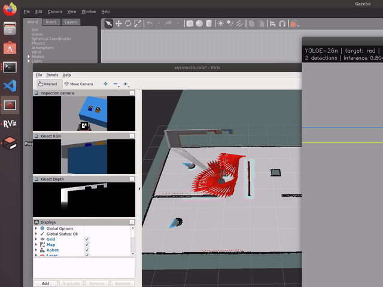
<br><sub><b>模式 2.1 · 从 A 台抓</b><br>对准、夹爪闭合、抬起来</sub>
</td>
</tr>
<tr>
<td width="50%" align="center">

<br><sub><b>模式 2.1 · 放到 B 台</b><br>对准、下降、松开、退开</sub>
</td>
<td width="50%" align="center">

<br><sub><b>模式 2.2 · 语义取物</b><br>模型选中 obj_1，抓起来举一下再放回</sub>
</td>
</tr>
</table>

<p align="center">

<br><sub><b>AUV · 入水与下潜</b>　RoboCup 水下机器人赛项现场</sub>
</p>

完整版的 MP4（也是 2–5 倍加速）我放在 <a href="#二模式21全自动建图与自主取送">模式 2.1</a>、<a href="#三模式22视觉语言模型驱动的语义取物与可解释技能执行">模式 2.2</a> 和 <a href="#五auv-进阶实践成果佐证">AUV</a> 那几节里了。

---

## 目录

- [现场演示](#现场演示)：5 段动图，建图、抓取、放置、语义、AUV
- [一、项目概览](#一项目概览)：环境、4 个入口、1 套底层，仓库里都有什么
- [二、模式 2.1：全自动建图与自主取送](#二模式21全自动建图与自主取送)：382.9 s 自己探索、A 台抓 B 台放、返航
- [三、模式 2.2：视觉语言模型驱动的语义取物与可解释技能执行](#三模式22视觉语言模型驱动的语义取物与可解释技能执行)：模型受限决策，ROS 六项校验
- [四、基础任务与其余入口](#四基础任务与其余入口)：task1 到 task3，模式 1 和模式 3
- [五、AUV 进阶实践（成果佐证）](#五auv-进阶实践成果佐证)：水下机器人比赛的记录，只有材料没有代码
- [六、复现与验证](#六复现与验证)：怎么把它跑起来
- [七、仓库说明](#七仓库说明)：收录范围、第三方许可、还没解决的问题
- [媒体索引](docs/MEDIA_INDEX.md)：85 张截图 · 5 段 GIF · 4 段视频，以及原始文件名和视频处理参数

---

## 一、项目概览

这门课我是这么走过来的：先自己写节点，把话题、服务、TF2、PID 挨个跑通；然后拿同一套底盘和机械臂，做了四种控制入口，键盘、语音、全自动，还有视觉语言模型。

四种入口底下共用同一套东西。URDF、传感器、TF 树、MoveIt 场景、夹爪插件、速度门控，都是同一份，我没为哪一个入口单独再写一遍。真正不同的只有一件事：谁来决定目标、什么时候动手。

| 入口 | 谁来决定 | 用到的东西 | 能做什么 |
| :--- | :--- | :--- | :--- |
| 模式 1 | 我，用键盘 | ManualAction、速度门控 | R 收臂解锁，W/S/A/D 开车，P/O 抓放 |
| 模式 2.1 | 程序自己（地图、frontier、YOLO 候选） | GMapping、AMCL、move_base、MoveIt、视觉 PID | 一条命令：建图、定位、A 台抓、B 台放、返航 |
| 模式 2.2 | 模型，在候选编号里挑一个 | 直接复用 2.1 的抓放技能 | 说一句话，机器人自己挑目标并 execute |
| 模式 3 | 我，用固定语音指令 | ManualAction、速度门控 | "小车前进"这类有限指令，走同一个安全出口 |

<details>
<summary><b>实验环境</b></summary>

| 项目 | 实际配置 | 说明 |
| :--- | :--- | :--- |
| 操作系统 | Ubuntu 18.04.6 LTS，内核 5.4.0-150 | VMware 虚拟机 |
| ROS | Melodic，roscore 1.14.13 | Python 2.7.17 / rospy |
| 仿真 | Gazebo 9.0.0 | ODE 物理引擎 |
| 机器人 | TurtleBot3 Waffle + OpenMANIPULATOR | MoveIt 1.0.11 |
| 工作空间 | `/home/jiayuexie/ROS` | task1、task2、task3、final_project |
| 构建 | `catkin_make -j2 -l2` | 4 GB 内存的虚拟机，只能限流跑 |
| 语义模型 | Qwen3-VL-4B-Instruct-GGUF（Q4_K_M + F16 mmproj） | Windows 侧 llama.cpp CUDA |

版本我是锁死的。Melodic 跟 Python 2.7 绑定，Gazebo 9 的差速插件和 MoveIt 1.0.11 的接口跟 Noetic 都不一样。后面所有命令和数值，都是按这套版本跑出来的。

</details>

### 仓库结构

```text
me-and-ROS/
├── ROS/src/
│   ├── task1/                  # Hello ROS
│   ├── task2/                  # 自定义消息、话题、学号查询服务
│   ├── task3/                  # 动态 TF2 + 双通道 PID 小乌龟跟随
│   └── final_project/          # 核心工程：四入口 + 建图取送 + 语义取物
│       ├── scripts/            # mission_server、automatic_delivery、semantic_mission…
│       ├── src/                # 探索节点、条件抓取插件、控制库
│       ├── launch/             # simulation / mode22 / navigation / manipulation
│       ├── embodied/app.py     # 模式2.2 Windows 操作台
│       ├── vision/             # YOLOE-26n-seg ONNX 与导出脚本
│       ├── voice/              # 讯飞流式听写接入
│       ├── config/ urdf/ worlds/ maps/ models/
│       ├── README.md           # 工程级详细说明
│       └── VALIDATION.md       # 逐轮部署与运行验证记录
├── docs/
│   ├── RUNBOOK.md              # 原始运行手册（逐条命令）
│   ├── MEDIA_INDEX.md          # 图片/视频原始文件名对照
│   ├── OPENSOURCE_SURVEY.md    # 导航/语音/机械臂方案调研
│   └── media/                  # 模式2.1、2.2、其余入口的截图与演示视频
└── AUV/                        # 比赛成果佐证（不含任何源代码）
```

---

## 二、模式 2.1：全自动建图与自主取送

这个模式我想做到一件事：敲一条命令，机器人从空白地图开始，自己探索、自己存图、自己定位，然后把 A 台的东西抓起来放到 B 台，最后回待命点停车。整个过程我不用点目标，不用选方向，也不用确认。

```bash
roslaunch final_project simulation.launch mode:=2 target_color:=red
```

### 完整流程

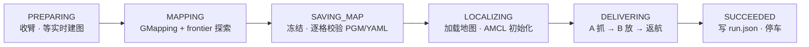

六个阶段各花多久，我按仿真时间记了下来：

| 阶段 | 入口时刻 / s（仿真） | 阶段耗时 / s | 这一阶段做的事 |
| :--- | ---: | ---: | :--- |
| `PREPARING` | 0.304 | 6.1 | 收回机械臂，等实时建图可用 |
| `MAPPING` | 6.374 | 384.4 | 自动 frontier 探索，边走边建图 |
| `SAVING_MAP` | 390.796 | 1.1 | 冻结地图快照，逐格核对 |
| `LOCALIZING` | 391.872 | 2.9 | 停建图、起 AMCL、静止校正 |
| `DELIVERING` | 394.820 | 248.9 | A 台抓取、B 台放置、返航 |
| `SUCCEEDED` | 643.748 | — | 终态验收并写盘 |

表里是仿真时间。交付那段按墙钟算是 529.6 s，换算下来实时率约 0.47。截帧、录像这些观测开销跟物理仿真开销是分开算的，验收动作本身没有改控制参数。

### 我花心思比较多的地方

**探索这块，我先把"去哪儿看"变成了一个有限的清单。** frontier 就是已知空地和未知区的交界线。我没直接拿这条线的中心当目标，而是隔一段取一个点，最多取 20 个。每个点周围按 3 个半径（0.35、0.55、0.80 m）和 16 个方向摆出候选观察位。一个候选要同时满足 `safe(p)`（落在已知空地上、容得下机器人）和 `visible(p,f)`（到 frontier 的连线不被障碍挡住），0.12 m 以内的算重复，只留一个。排序用的代价是：

```text
S(p) = ‖p − r‖ + 0.5 · ‖p − f₀‖
       └─行驶成本─┘   └─离 frontier 过远的惩罚─┘
```

排好序的前 12 个，我还会逐个调 `make_plan` 确认当前地图上真能走通，才交给 `move_base`。失败的点记在 0.35 m 的范围内，同一处 frontier 最多试两次。frontier 最小按 0.30 m 算，边界点之间最大的跨度也要 ≥ 0.30 m，这样就不会反复去戳一小块未知斑块的弯曲边缘。

什么时候算建完，我没用计时，而是看有效 frontier 是不是用光了，或者只剩一小块封闭的未知区。跟剩余边界连着的未知区按四邻域搜一遍，每块 ≤ 0.20 m²、加起来 ≤ 0.30 m²，而且不能伸出搜索范围或地图边缘。比起"看着差不多了"，这个条件我能拿面积去核对。

**建图切到定位那里，我卡了一阵。** GMapping 跑着的时候会发 `map→odom`，AMCL 起来后也发这一条。两个同时发，TF 树就冒出两个父节点，导航和 RViz 都乱了。所以我在状态机里把建图和定位排成一前一后：先停车、把地图定格、逐格核对 PGM/YAML，再停掉建图节点，最后加载地图、启动 AMCL。

AMCL 我也没让它从零全局定位，而是拿保存地图时机器人的位姿当起点，连着做 8 次静止更新，要求协方差对角项 ≤ 0.04、交接修正 ≤ 0.5 m / 0.5 rad。这次实测静止校正 0.666 s，最大位移 **0.000728 m**，最大航向漂移 **0.000136 rad**。

**抓和放我设了三道检查，哪道不过就不动手。**

| 层次 | 判据 | 不过的话 |
| :--- | :--- | :--- |
| 视觉对位 | 误差进入 \|e_d\| < 0.012 m、\|e_θ\| < 0.04 rad 后先发零速度，再连续稳定 0.25 s 才返回 | 继续对；超 2.0 s 或丢帧超 3.0 s 就停车 |
| 夹爪反馈 | 闭合误差 ≤ 0.005 m、张开误差 ≤ 0.002 m、稳定 0.2 s | 抛 `Gripper feedback mismatch`，不调用抓取 |
| 几何包络 | 两指关节位置 ≤ 0.008 m **且**盒心与末端原点 3D 距离 ≤ 0.035 m | 拒绝附着，回报 `outside the 35 mm grasp envelope` |

抓取点我同时看 ALVAR 标记和 Gazebo 里的模型状态。一般是标记说了算，两者差超过 0.02 m 就改用模型状态。放置也一样，不是松手就算完：松手后 5 s 内反复读模型状态，平面误差 < 0.08 m、高度误差 < 0.025 m、线速度 < 0.03 m/s 三个同时满足，我才记下 `placement_error`。

### 这次跑出来的数

| 项目 | 结果 |
| :--- | :--- |
| 探索结束 | 仿真 382.878 s，`failures=0`，残余 0.25375 m²（0.1000 / 0.0844 / 0.0694 三块，都 < 0.20 m²） |
| 地图 | 352 × 672 栅格，分辨率 0.025 m，origin [-4.5, -3.5] |
| AMCL 静止检查 | 0.666 s，最大位移 0.000728 m，最大航向漂移 0.000136 rad |
| A 台对位 | −0.00716 m / 0.02788 rad（visual = true） |
| B 台对位 | 0.01172 m / 0.02089 rad（visual = false） |
| 抓取 | 成功，最大 FK 回代残差约 1.14 × 10⁻¹⁶ m |
| 放置误差 | 0.07858 m（容差 0.08 m，余量 1.42 mm） |
| 终态 | `HOLD`、`attached=False`、`cmd_vel` 全零；红盒在 B 台，机器人回到待命区 |
| 恢复动作 | 导航重试 1 次、导航与 PID 交接 3 次，仍然收敛到终态 |

<div align="center">
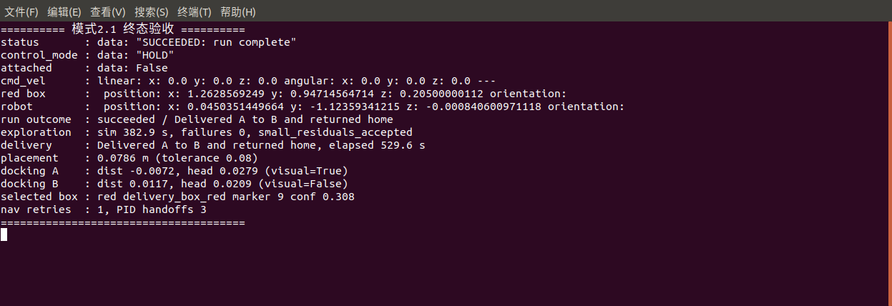

<sub>终态验收终端：status / control_mode / attached / cmd_vel / 物体与机器人位姿 / 对位与放置误差</sub>
</div>

### 现场截图

**整体看一眼**

<div align="center">
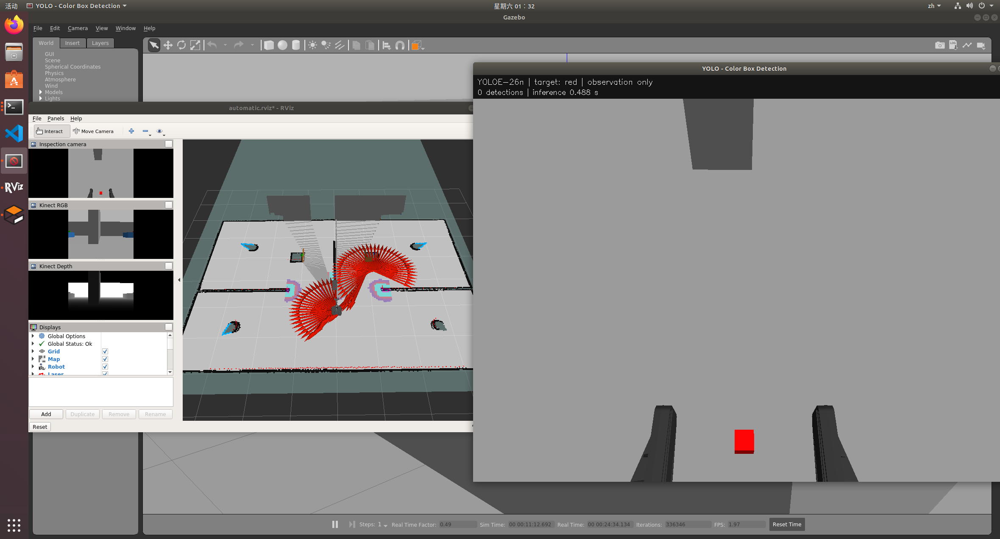
</div>

Gazebo 世界、RViz 地图和传感器、YOLO 观察窗口、终端状态都在同一个屏幕上。

**建图，从空白到闭合**

<p align="center">

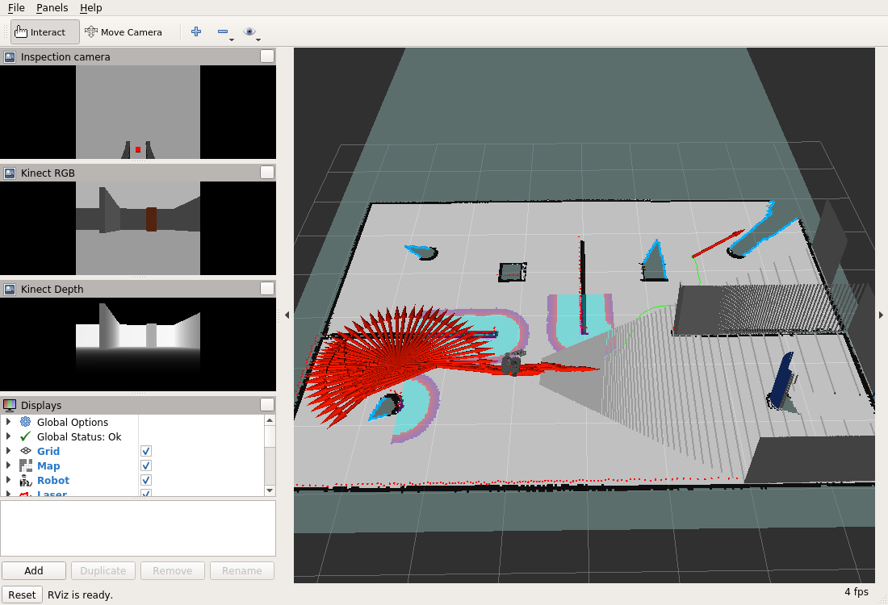
</p>
<p align="center">

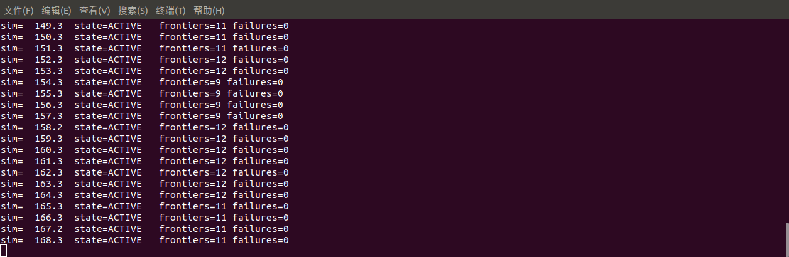
</p>

上排是建图中期和后期，墙一点点闭合、激光束变长；下排左边是最终栅格地图，右边是探索状态的终端，frontier 在递减，`failures=0`。

**抓和放**

<p align="center">
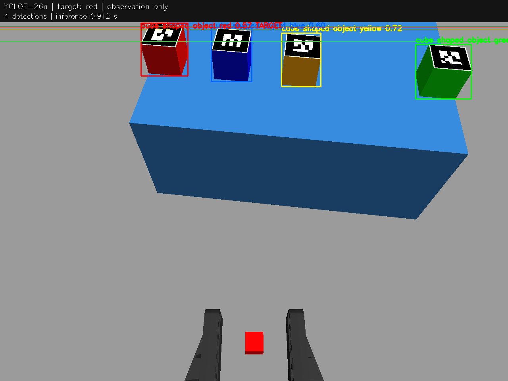

</p>
<p align="center">

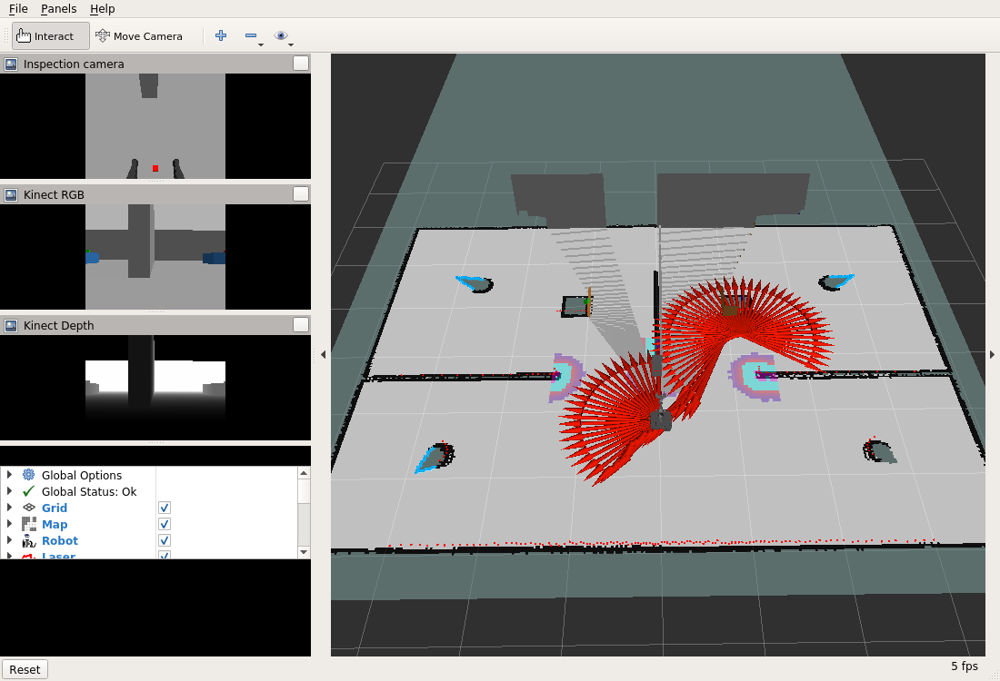
</p>

上面是 A 台同帧检出的红、蓝、黄、绿四个盒子（目标色是红），红盒被夹起来；下面是 B 台释放和返航停车后的 RViz 地图。

动作序列联络表是我从 2 fps 的录像里抽帧拼出来的，检测、对位、抓放、退离都覆盖了：

<p align="center">

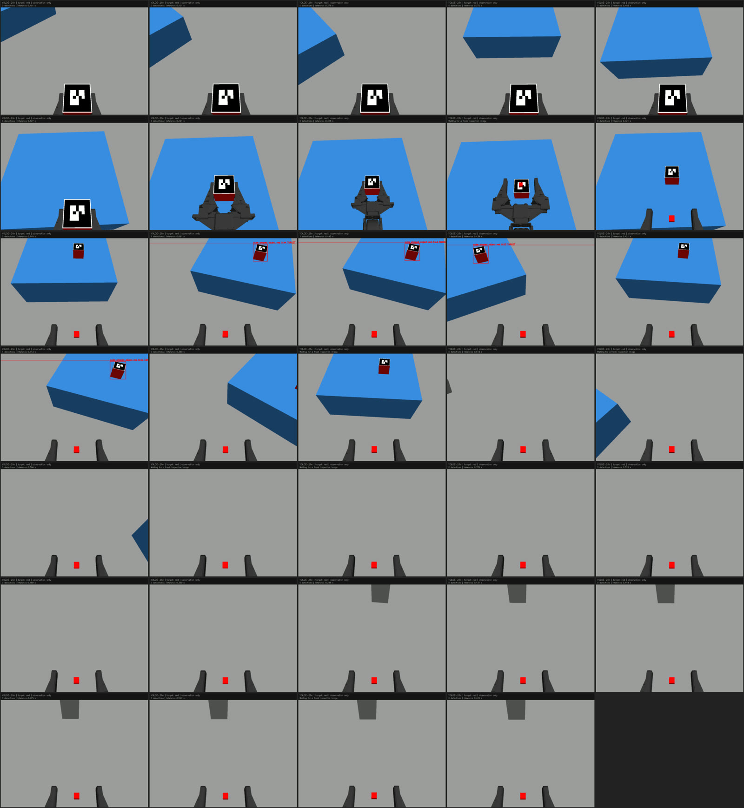
</p>

### 演示视频

视频我都做了 2 倍加速，只留核心片段，用 H.264（CRF 28）重编码，一段压到 1 MB 左右。首屏那些动图就是从这几段 MP4 压出来的预览。这里有个 GitHub 的限制我绕不过去：README 会把 `<video>` 标签剥掉，仓库里的 MP4 没法直接嵌在页面里播，所以完整版只能开链接看。

<table>
<tr>
<td width="33%" align="center">
<a href="docs/media/video/mode2_1_pick.mp4"></a>
<br><sub><b>A 台抓取</b><br>59 s · 2× 加速<br>对准、夹取、抬升</sub>
</td>
<td width="33%" align="center">
<a href="docs/media/video/mode2_1_place.mp4">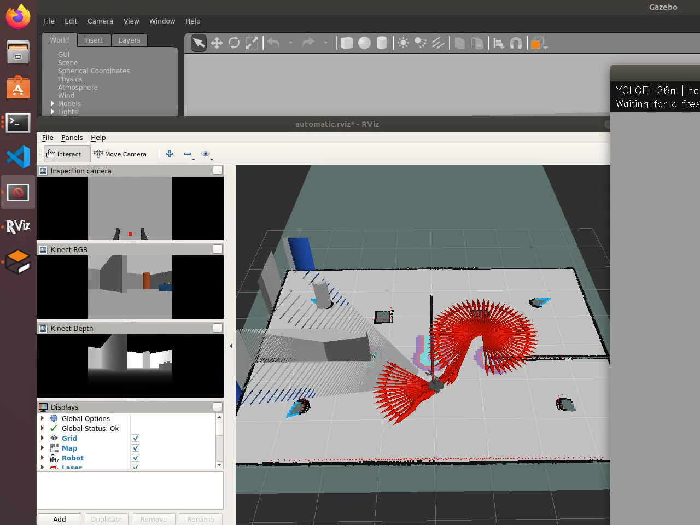</a>
<br><sub><b>B 台放置</b><br>62 s · 加速 2×<br>对准、下降、松开、退开</sub>
</td>
<td width="33%" align="center">
<a href="docs/media/video/mode2_1_mapping.mp4"></a>
<br><sub><b>建图延时</b><br>7 s · 2× 加速<br>frontier 探索，地图生长</sub>
</td>
</tr>
</table>

### 我踩过的一个坑

第一轮抓取只回了一句 `Object is outside the 35 mm grasp envelope`。看着像是抓取插件拒绝了，其实是几个误差在近距离上叠到了一起：ALVAR 近距离斜着看，给出的标记点跟 Gazebo 模型点差了约 **3.3 cm**，再加上 **1.2 cm** 的抓取高度偏差，末端到盒心的三维距离刚好超过 35 mm。

我当时的选择不是把容差放宽，而是加了一个一致性校正。视觉对位照旧，只在标记点和模型点差超过 2 cm 时改用模型状态作为最终抓取点，触发条件和替换规则都写进了状态里。

```text
Grasp target corrected: marker=(0.268, 0.007) model=(0.267, -0.025) error=0.033 m
```

<p align="center">

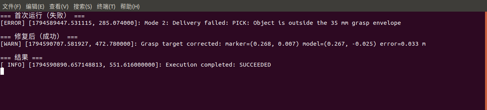
</p>

左边是第一轮 35 mm 包络失败的现场，右边是模型一致性校正的日志。改完之后 PICK、PLACE、RETURN_HOME 都成功了。

### 复现

```bash
cd /home/jiayuexie/ROS
source /opt/ros/melodic/setup.bash
chmod +x src/final_project/scripts/*.py src/final_project/tools/render_robot.py
catkin_make -j2 -l2
source /home/jiayuexie/ROS/devel/setup.bash
roslaunch final_project simulation.launch mode:=2 target_color:=red
```

想看阶段变化或者中途叫停：

```bash
rostopic echo /final_project/status
rostopic echo /final_project/exploration/status
rosservice call /final_project/mode2/cancel '{}'
```

取消或者失败之后车保持停车，已经抓着的东西不会自动松爪。重新执行启动命令会清掉旧现场、开始新任务。参数、话题和各阶段的细节在 [`final_project/README.md`](ROS/src/final_project/README.md)。

---

## 三、模式 2.2：视觉语言模型驱动的语义取物与可解释技能执行

这个模式里，模型只负责挑一个，手还是机器人自己动。Qwen3-VL 从当前画面的候选编号里选一个，给我 `decision / candidate_id / summary` 三个字段；坐标、速度、关节角这些我不让它碰。ROS 这边再核对颜色、画面旧不旧、置信度排序、物体实际位置、ALVAR 标记，然后沿用模式 2.1 那套视觉 PID、抓取限制、举示 2 s、放回原位、退离停车。

### 数据流

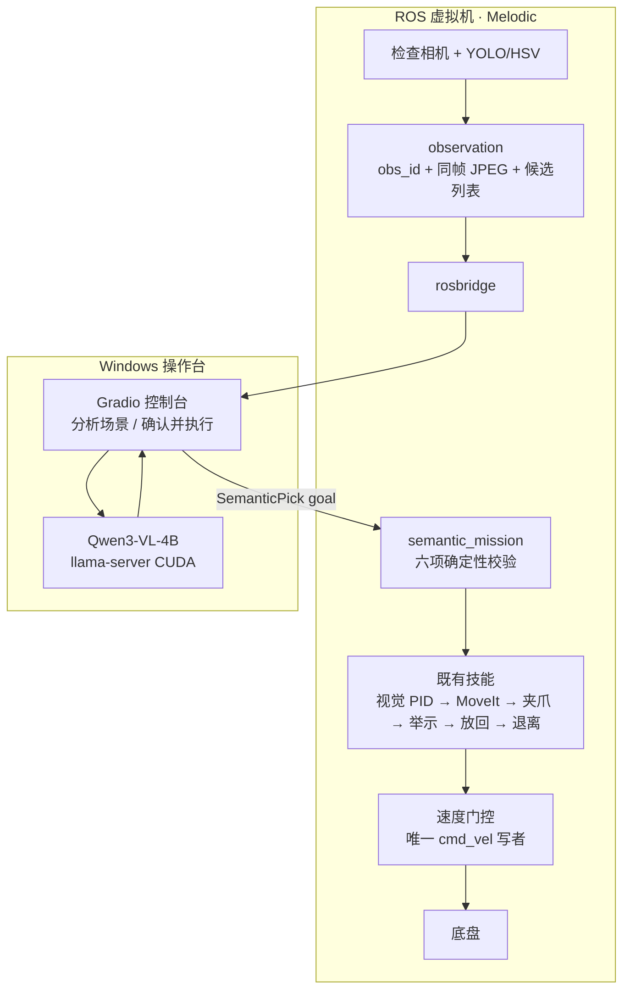

观察话题 `/final_project/embodied/observation` 按 **2.6–2.8 Hz** 发；每一帧里有 `observation_id`、同帧 JPEG，还有 YOLO 给出的候选（`candidate_id`、颜色、标签、置信度、bbox）。动作目标必须引用还有效的观察帧，过期的不算。

### 怎么让模型只做选择题

我把它做成了一道选择题。画面里有候选集合 `C = {c₁ … cₙ}` 和这一帧图像 `I`，模型输出 `d* = argmax_{c∈C} s(I, c)` 和一个决策标签。控制台还做了防误触：没点"分析场景"就去点"确认并执行"，界面会回"请先分析当前场景"，**不会给 ROS 发任何 goal**；就算分析过了，执行前还要再确认候选仍在当前这一帧里、而且是置信度最高的那个。

| 约束项 | 取值 |
| :--- | :--- |
| 固定中文指令 | "拾取当前视野中 YOLO 检测置信度最高的目标盒子，完成举示动作后放回原位" |
| 模型输入 | 同帧带标注 JPEG + 候选列表 |
| 输出 schema | `decision ∈ {answer, pick_show_return, clarify}`、`candidate_id`、`summary` |
| 解码参数 | `temperature=0`、`max_tokens=256`、`response_format=json_schema` |
| 显式禁止 | 不生成坐标、速度、关节角 |

### ROS 这边我加了六道检查

动手之前，`semantic_mission` 要把这六项都过一遍，任何一项不满足就抛异常、Action 判失败、机器人保持停车：

| 校验 | 内容 | 失败说明 |
| :--- | :--- | :--- |
| `V_color` | 目标颜色必须在 `colored_boxes` 里 | 指令越界了 |
| `V_age` | 最近 256 条观察历史里能找到该 `observation_id`，且距接收 ≤ 300 s | 拿旧场景执行新命令 |
| `V_candidate` | `candidate_id` 存在且颜色与 goal 一致 | 候选串号 |
| `V_argmax` | 候选必须是该帧 YOLO 置信度最高的 | 模型选了不是最优的 |
| `V_pose` | 读模型状态，确认盒子还在 A 台期望位置 0.12 m 内 | 东西被移走了 |
| `V_marker` | 模型名与 ALVAR 标记绑定一致（黄 8 / 红 9 / 绿 10 / 蓝 11） | 物理身份对不上 |

前四项光看观察历史和 goal 就能算，后两项才要去问 Gazebo。我把便宜的检查放前面，不过就直接短路。这么排不是为了快，是出于安全：先用不费力的条件把明显有问题的 goal 挡掉，再用实际状态确认"这东西现在确实还在 A 台"。

### 三层兜底

| 检查层 | 规则 | 失败结果 |
| :--- | :--- | :--- |
| Windows 控制台 | 必须先分析；候选仍存在；必须是最高置信度 | 拒绝执行，不发 goal |
| ROS 语义节点 | observation ≤ 300 s；颜色一致；最高置信度；模型在 A 台 0.12 m 内 | Action 失败，保持停车 |
| 运行时 | Windows 心跳 ≤ 3 s；每个阶段检查取消 | `stop()`，零速度，取消机械臂和夹爪 |

心跳监测就放在取消检查里，超过 3 s 就停车。`SHOW` 阶段每 50 ms 查一次，所以"举示 2 s"不是一个打断不了的过程。动作按顺序是：

```text
VALIDATE_TARGET → PREPARE → DOCK_PICK_PID → PICK → SHOW（2 s） → PLACE（原位） → RETREAT（0.15 m） → SUCCEEDED
```

### 这次跑出来的数

| 项目 | 结果 |
| :--- | :--- |
| 观察帧 | `obs_835`；同一观察位检出红、蓝、黄、绿四个候选 |
| 模型决策 | `pick_show_return`，`candidate_id = obj_1`（黄），置信度 0.2562 |
| 模型耗时 | 2.982 s（本地 4B 量化模型，CUDA） |
| 动作耗时 | 110.31 s，`success=true` |
| 终态 | `SUCCEEDED: Semantic pick/show/return completed`，`attached=False`，`mode=HOLD`，`cmd_vel` 全零 |
| 放回精度 | 黄盒 (−1.2012, 0.9154, 0.2050)，与原始 (−1.20, 0.90, 0.205) 平面偏差约 **0.0154 m** |
| 退离 | 0.150 m，与配置一致 |

<p align="center">
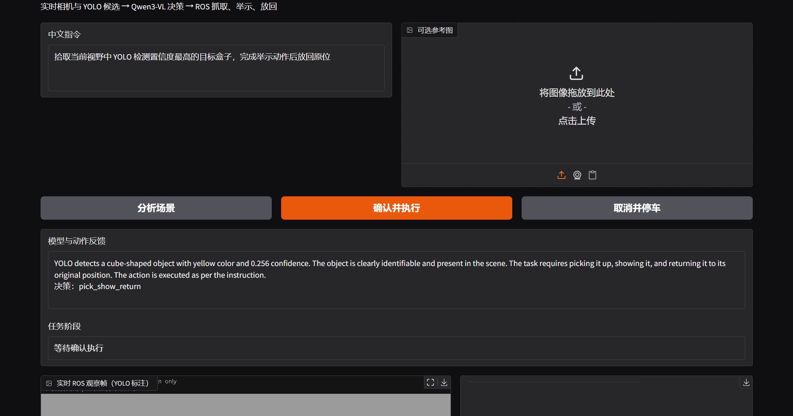
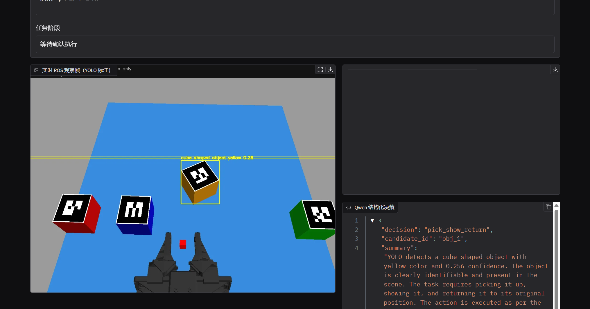
</p>

左边是 `decision=pick_show_return`、`candidate_id=obj_1`、置信度和推理耗时；右边是同帧图像和结构化 JSON，里面没有任何坐标、速度或关节角。

### 现场截图

**观察和拦截**

<p align="center">

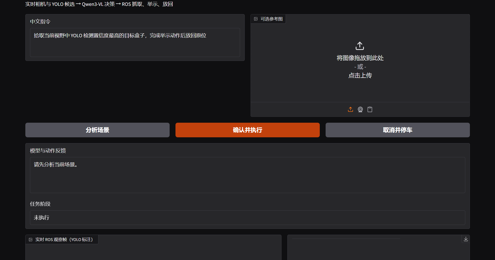
</p>

左边同一帧检出四个候选，"多候选择一"不是空话；右边是没分析就直接执行被拦下来的样子，阶段显示"未执行"。

**执行链：对准、抓取、举示、放回、退离**

<p align="center">
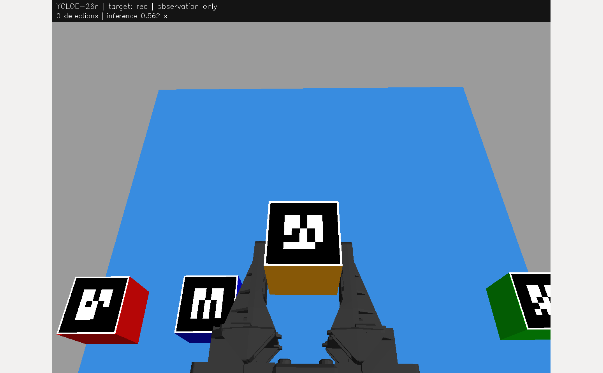
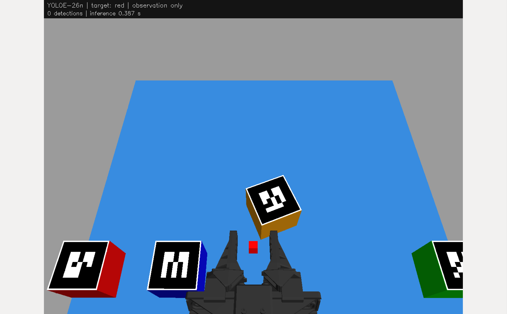
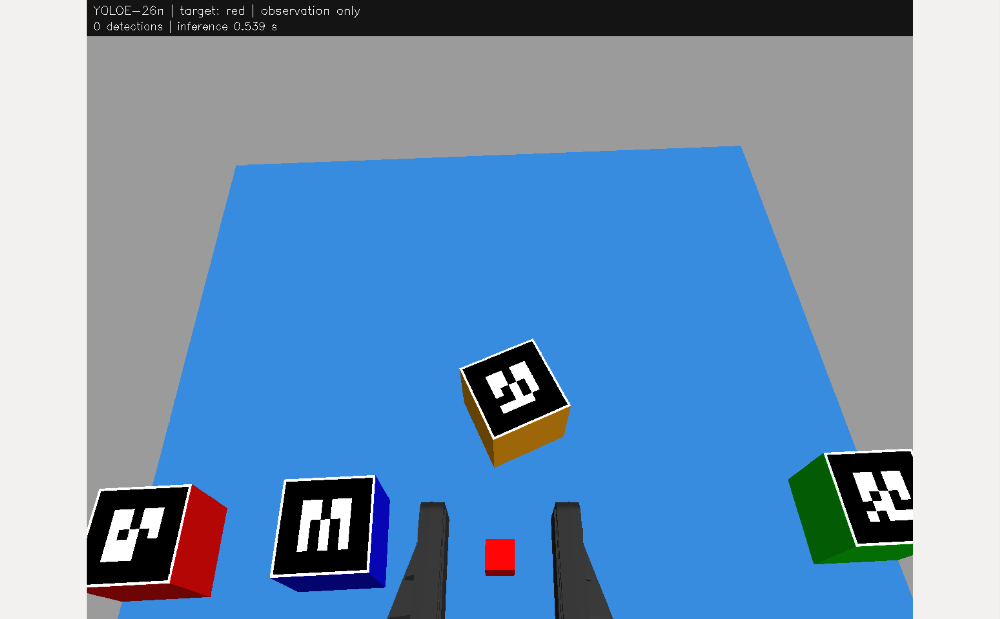
</p>
<p align="center">
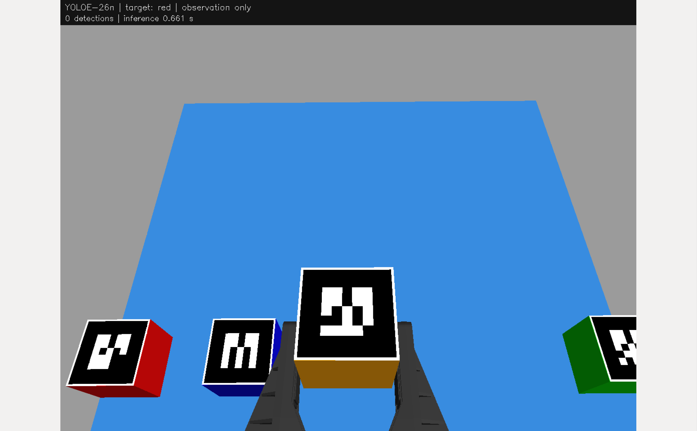


</p>

上排是夹爪对准黄盒、抓起来离台、举示保持 2 s；下排是放回原位、YOLO 恢复检测、退离后的终态。

**终态验收**

<div align="center">
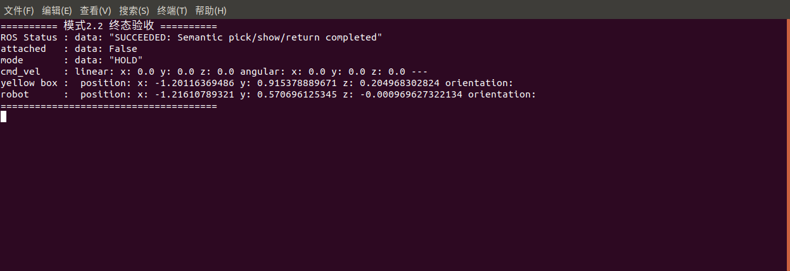
</div>

`SUCCEEDED`、`attached=False`、`HOLD`、零速度，黄盒坐标和机器人退离的位置同屏可核。

### 演示视频

<table>
<tr>
<td width="60%" align="center">
<a href="docs/media/video/mode2_2_semantic_pick.mp4"></a>
<br><sub><b>语义取物全流程</b> · 66 s · 2× 加速<br>观察、受限决策、对准、抓取、举示、放回、退离</sub>
</td>
<td width="40%" align="left">
<b>看的时候可以留意三点：</b><br><br>
① 机器人始终只做选中的那一个：四个候选同时在，但只抓 `obj_1`；<br>
② 举示阶段明确保持 2 s，之后是放回原位，不是随手丢下；<br>
③ 退离后 YOLO 又检出四个目标，说明东西确实离开了夹爪、稳稳落在台面上。
</td>
</tr>
</table>

### 复现

虚拟机这边要先装 `rosbridge_server` 并重新构建：

```bash
cd /home/jiayuexie/ROS
source /opt/ros/melodic/setup.bash
catkin_make -j2 -l2
source /home/jiayuexie/ROS/devel/setup.bash
roslaunch final_project mode22.launch
```

Windows 这边先起本地模型服务，再起操作台：

```powershell
Start-Process -FilePath 'E:\Project\llama.cpp-b11836-win-cuda12\bin\llama-server.exe' -ArgumentList @(
  '-m','E:\Project\models\Qwen3-VL-4B-Instruct-GGUF\Qwen3VL-4B-Instruct-Q4_K_M.gguf',
  '--mmproj','E:\Project\models\Qwen3-VL-4B-Instruct-GGUF\mmproj-Qwen3VL-4B-Instruct-F16.gguf',
  '-c','4096','-np','1','--image-min-tokens','1024','-ngl','99','--host','127.0.0.1','--port','8080')

& 'E:\Programming\.conda\envs\mode22\python.exe' `
  'F:\University\Course\dasanshang\ROS_class\ROS\src\final_project\embodied\app.py' `
  --ros-host 192.168.162.132 --server-port 7860
```

有个坑我记一下：`app.py` 和 README 默认的 `--ros-host` 是 `192.168.162.131`，这次实测虚拟机是 `.132`，运行时我用参数覆盖了。写在这里是免得下次"连不上"被误判成 ROS 节点坏了。

---

## 四、基础任务与其余入口

| 模块 | 做了什么 | 验收结果 | 证据 |
| :--- | :--- | :--- | :--- |
| task1 Hello ROS | 最小节点：初始化、`loginfo`、退出 | 输出一次 `Hello ROS!`，进程正常结束 | `docs/media/tasks/task1_hello_ros.png` |
| task2 通信机制 | `Student` 消息（4 字段）、`QueryStudent` 服务、1 Hz 话题、参数服务器 | 1 Hz 稳定，`found=true/false` 两路都对；学号前导零在消息、YAML、命令行三处都保住了 | `docs/media/tasks/task2_*.png` |
| task3 TF2 + PID | 双广播器、相对位姿、双通道 PID（微分低通、条件积分、朝向限速、滞回停车） | 20 Hz 控制，终距 0.094–0.098 m，到达后不抖 | `docs/media/tasks/task3_follow_*.jpg` |
| 模式1 键盘 | R 收臂解锁、W/S/A/D、T 速度档、1/2 站点、P/O 抓放、空格取消 | 按键都通；P/O 成功；空格同时清速度和取消动作 | `docs/media/mode1/*.png` |
| 模式3 语音 | 讯飞流式听写、文本归一化、闭集解析，走同一个速度门控 | 四类指令都接受；真麦克风完成了"状态、准备、微调前进、停止" | 见 `docs/RUNBOOK.md` 第 5 节 |

<p align="center">
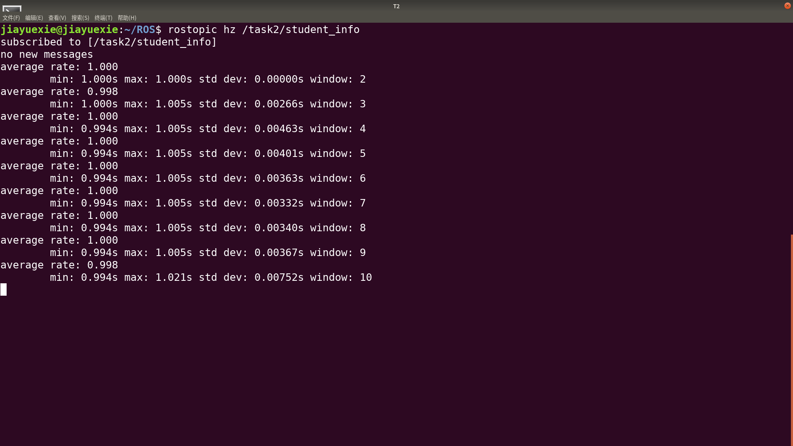
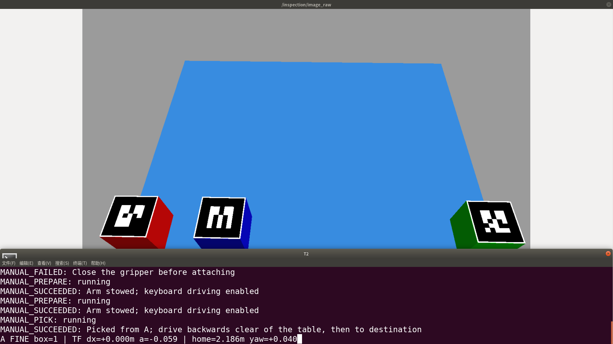
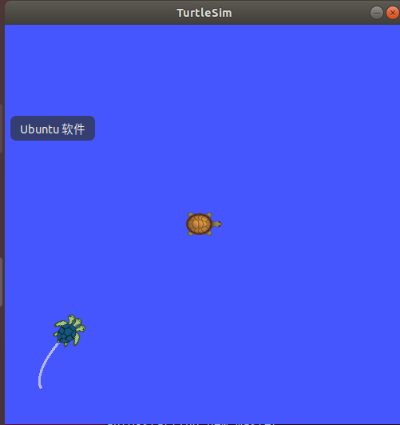
</p>

左边是 `rostopic hz` 稳定在 1 Hz，中间是模式1 按 P 把箱子抬起来，右边是双龟跟随的相对位姿和速度。

<details>
<summary><b>四种入口为什么能共用一套底盘</b></summary>

因为底盘速度只有一个出口。`velocity_gate` 是 `/om_with_tb3/cmd_vel` 唯一的发布者，按模式从 `MANUAL`、`NAV`、`DOCK` 三个来源里挑一个，模式对不上就发零速度。手动命令缓存 0.3 s，导航和对位命令缓存 1.0 s，超时就算过期；线速度限在 [−0.08, 0.18]，角速度限在 [−0.7, 0.7]。最后还有一道激光保护：运动方向 ±0.35 rad 内检测到障碍（前进 0.14 m、后退 0.29 m）就直接停车，扫描没数据或超过 1.0 s 没更新也停。

这样"安全"就不用每个入口各做一套了，大家共用一个出口。所以模式1 的 R 互锁、模式2.2 的心跳停车、模式3 的 STOP 优先级能同时存在，不会互相打架。

</details>

---

## 五、AUV 进阶实践（成果佐证）

先说清楚：这个目录里只有比赛的成果材料，AUV 的源代码一行都没有。那个工程后面还要接着比赛，代码、工程目录、模型权重、完整原始录像我都没往上传，`.gitignore` 里专门写了拦截规则。

课程里学的 ROS 通信、TF、PID、launch、状态机和录制方法，放到真的水下机器人上，光"能跑通"不够，还得"可信"。水下没有 GPS，池壁反光加上水浑，摄像头经常看不清，正式比赛要求拔掉调试线自己跑。2026 年我拿这台自己做的 AUV 参加了中国机器人大赛暨 RoboCup 机器人世界杯中国赛的水下机器人赛项（水中巡游项目），在 5 m × 10 m 的水池里做了正式下水尝试。

<p align="center">
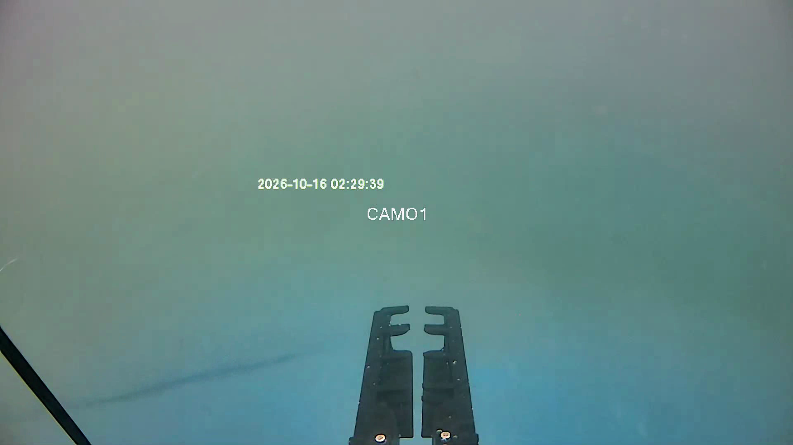
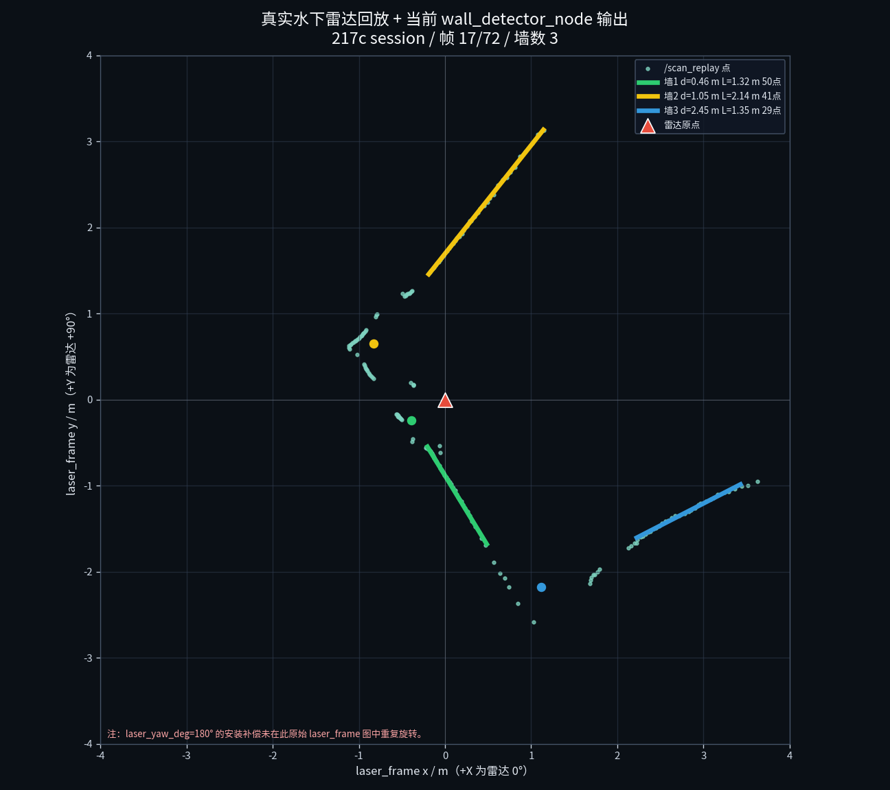
</p>

左边是比赛水池里的前视画面（水体蓝绿，底部是 AUV 前部结构），右边是真实水下雷达帧的多墙 RANSAC 拟合。

### 软件分层

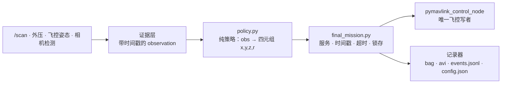

三条约束从头到尾没变：证据不创造目标（缺失、歧义、过期就返回空，不拿旧值补）、唯一写者（所有运动请求经 `MotionCommand` 走同一个飞控桥接）、失败锁存（压力、航向、飞控、记录、回执任一失效就 `ABORTED`，不自动重跑）。

### 跑出来的结果

| 项目 | 条件 / 输入 | 结果 |
| :--- | :--- | :--- |
| 纯策略测试 | `test_final.py`，35 项 | **35/35 通过**，0.985 s |
| 状态机演示 | 确定性观测序列 | 28.7 s 到达 `DISARMING` |
| 赛场会话 981 | 1918 条状态，99.2 s，深度 −0.001–0.838 m | 下潜、`FORWARD`、`BACK`，最后停在 `LEFT` |
| 赛场会话 31be | 1082 条状态，57.4 s | 47.32 s 航向修正超时，锁存 `ABORTED` |
| 雷达墙检测 | 217c bag，850–862 s 窗口 | 稳定检出 1–3 面墙，最佳帧 0.459 / 1.054 / 2.445 m，RMS 7.3 / 7.9 / 13.0 mm |
| 球检测 | 217c 左目，141.5–147.0 s | 16 次 `blue_ball`（置信度 0.38–0.84），**0 次通过门控** |

<p align="center">


</p>

左边是状态机的确定性演示，右边是真实赛场会话 981ac8a2 的状态、深度、航向和请求时间线。

### 三个我印象很深的坑

1. **有闭环不等于能收敛。** 31be 那次目标航向约 70°，偏航速率请求从 −158 一路衰减到 −107，30 s 内误差始终没回到 −1°，适配层捕获超时后锁存中止。推进器推力、初始角速度、飞控限幅、水流，哪一个都能让闭环失败。
2. **归一化宽高比是个坐标系统陷阱。** 16:9 画面里归一化宽高比等于像素宽高比乘 0.5625；真实蓝球的归一化宽高比是 0.306–0.425，全被 0.5–2.0 的门控拒了，`ball_x` 一直是空的。问题不在"模型没检出"，是检测框进入策略时的几何条件写错了坐标系。
3. **"未确认"必须写进日志。** 前进结束记 `impact unconfirmed`，后退结束记 `rear contact unconfirmed`，左移结束记 `return unconfirmed`。定时到了、靠近墙了、球消失了，都不等于撞球成功。

### 材料索引

| 目录 | 内容 | 数量 |
| :--- | :--- | :--- |
| `AUV/figures/` | 架构图、任务时间线、航向中止、雷达三面墙拟合、球门控诊断 | 5 张 |
| `AUV/screenshots/` | 环境、工程结构、单元测试、状态机、墙检测、球检测、赛场 | 13 张 |
| `AUV/videos/` | 入水与下潜、状态机终端演示、雷达墙检测动画、蓝球检测标注、比赛水下片段 | 5 段 |
| `AUV/logs/` | 单元测试、状态机、真实会话摘要、墙与球检测、环境核验 | 25 份 |
| `AUV/data/` | 会话 CSV、雷达 JSONL、检测 CSV、演示参数副本 | 7 份 |
| `AUV/AUV_Project_Summary.md` | 完整文字版：算法、实验、图表索引、复现路径 | 1 篇 |

<p align="center">
<a href="AUV/videos/05_pool_launch_and_dive.mp4">▶ 入水与下潜（35 s）</a> ·
<a href="AUV/videos/04_competition_pool.mp4">▶ 比赛水下片段</a> ·
<a href="AUV/videos/02_lidar_wall_detection.mp4">▶ 雷达墙检测</a> ·
<a href="AUV/videos/03_ball_detection_annotated.mp4">▶ 蓝球检测标注</a> ·
<a href="AUV/videos/01_mission_state_machine.mp4">▶ 状态机演示</a>
</p>

---

## 六、复现与验证

每个新终端先做这个：

```bash
export LANG=C.UTF-8
export LC_ALL=C.UTF-8
export PYTHONIOENCODING=utf-8
source /opt/ros/melodic/setup.bash
source ~/ROS/devel/setup.bash
```

构建：

```bash
cd ~/ROS
catkin_make -j2 -l2
```

四个入口怎么起：

| 入口 | 启动命令 |
| :--- | :--- |
| 模式 1 键盘 | `roslaunch final_project simulation.launch mode:=1` 然后 `rosrun final_project keyboard_control.py` |
| 模式 2.1 全自动 | `roslaunch final_project simulation.launch mode:=2 target_color:=red` |
| 模式 2.2 语义 | `roslaunch final_project mode22.launch`，再加 Windows 操作台 |
| 模式 3 语音 | `roslaunch final_project simulation.launch mode:=3` |

逐条命令、按键含义、话题和服务清单在 [`docs/RUNBOOK.md`](docs/RUNBOOK.md)；每一轮怎么部署、哪里失败、怎么修的，在 [`ROS/src/final_project/VALIDATION.md`](ROS/src/final_project/VALIDATION.md)。

有一点我得说明白：仓库里所有数值都来自一次完整运行的日志和 `run.json`，我没拿它们去推成功率。抓取和放置的验收读的是 Gazebo 模型状态，仿真里够用，但不等于真实传感器的精度。

---

## 七、仓库说明

### 收录了什么

| 收录 | 内容 |
| :--- | :--- |
| `ROS/src/**` | task1、task2、task3、final_project 的全部源码、launch、config、URDF、地图和 ONNX 权重 |
| `docs/media/**` | 模式 2.1、2.2、模式1、task1 到 task3 的截图，以及加速裁剪过的演示视频 |
| `AUV/**` | 图表、截图、日志、数据和 5 段演示视频，只有佐证材料 |

| 没收录 | 为什么 |
| :--- | :--- |
| AUV 源代码（`Jetson_core_code/`、`tools/`、`ros_home/`） | 后面还要比赛，在研项目，不能公开 |
| AUV 原始录像和完整媒体库（约 878 MB） | 太大，而且有没脱敏的现场信息 |
| 课程报告 docx | 里面有姓名、学号这些个人信息 |
| catkin 的 `build/`、`devel/`、`logs/`、`backups/` | 构建产物和历史快照，没有源信息 |

### 第三方许可

自己写的部分主要是手动 Action、四种模式的接入、控制权切换、运动学校验、带条件判断的抓取插件，还有模式 2 里对探索做的改动和"建图、定位、取送"的先后协调。用到的第三方东西保留原来的许可：

- `urdf/upstream/*.xacro`、`config/robot.srdf`、ALVAR 标记贴图：ROBOTIS，Apache-2.0
- `src/third_party/explore_lite/`：`hrnr/m-explore`，BSD 三条款（含 Bosch / Jiri Horner 版权）
- `vision/`：Ultralytics YOLOE 的导出代码，AGPL-3.0（许可证随目录提供）
- GMapping、AMCL、move_base、MoveIt、ros_control、Gazebo：ROS Melodic 发行包
- 模式 2.2：Qwen3-VL-4B-Instruct-GGUF、llama.cpp、rosbridge_suite、roslibpy、Gradio

完整清单在 [`ROS/src/final_project/THIRD_PARTY.md`](ROS/src/final_project/THIRD_PARTY.md)。

### 还没解决的问题

- 模式 2.1 的结果来自一次完整运行，还是对定位比较敏感。B 台放置误差 0.07858 m，已经贴着 0.08 m 的容差了，说明松手时的接触和台面滑动我还没建模。
- 模式 2.2 只跑过一次语义取物。反向任务、连着做多次、动态障碍、真硬件都还没试。Qwen 推理 2.982 s，心跳 3 s，这套演示的快慢基本由这两个数定。
- 模式 3 的完整语音搬运、运动中语音停车还没验收。云端识别有延迟，精对位还得靠微调指令。
- AUV 部分是如实记录：真机上的流程跑通了，完整任务没完成，不宣称赛项满分。

---

<div align="center">
<sub>《Linux 基础及 ROS 应用实践》课程作业。只放了课程成果和脱敏后的比赛佐证材料。</sub>
</div>
