<div align="center">

# Me and ROS

**从通信机制、TF2 与双通道 PID，到全自动建图取送与视觉语言模型驱动的语义取物**

<sub>《Linux 基础及 ROS 应用实践》课程项目 · ROS 1 Melodic · Gazebo 9 · TurtleBot3 Waffle + OpenMANIPULATOR</sub>

<br>


</div>

---

## 现场演示

<sub>以下动图**加载后自动循环播放，无需点击**；均取自真实运行录像，已做 2–5× 加速与体积压缩。</sub>

<table>
<tr>
<td width="50%" align="center">
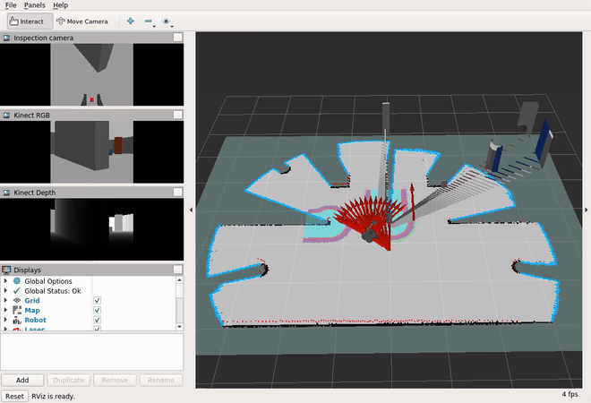
<br><sub><b>模式 2.1 · 自动建图</b><br>GMapping + frontier 探索，地图从空白长到闭合</sub>
</td>
<td width="50%" align="center">

<br><sub><b>模式 2.1 · A 台抓取</b><br>视觉对位 → 夹爪闭合 → 离台抬升</sub>
</td>
</tr>
<tr>
<td width="50%" align="center">
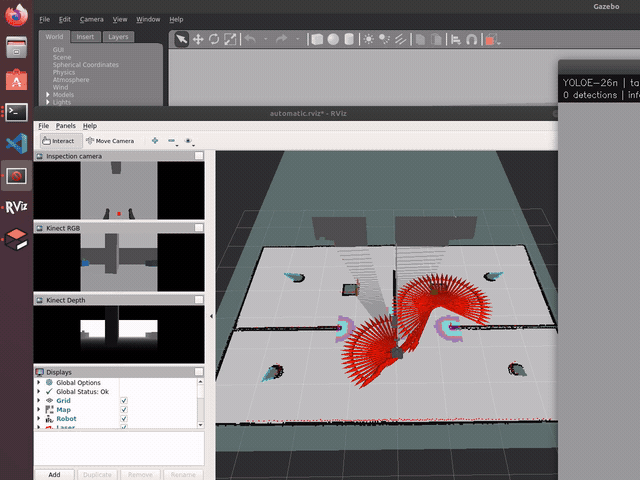
<br><sub><b>模式 2.1 · B 台放置</b><br>对位 → 下降 → 释放 → 退离</sub>
</td>
<td width="50%" align="center">
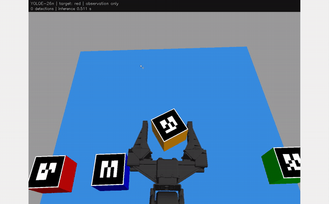
<br><sub><b>模式 2.2 · 语义取物</b><br>Qwen3-VL 选中 obj_1 → 抓取 → 举示 → 放回</sub>
</td>
</tr>
</table>

<p align="center">
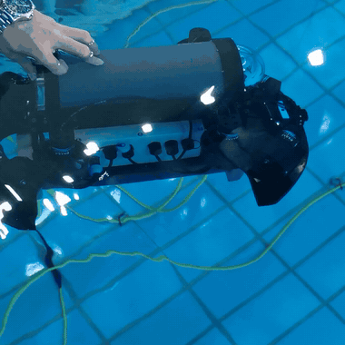
<br><sub><b>AUV · 入水与下潜</b>　RoboCup 水下机器人赛项现场</sub>
</p>

<p align="center"><sub>完整版 MP4（2–5× 加速）见
<a href="#二模式21全自动建图与自主取送">模式 2.1</a>、
<a href="#三模式22视觉语言模型驱动的语义取物与可解释技能执行">模式 2.2</a> 与
<a href="#五auv-进阶实践成果佐证">AUV</a> 章节；本区只负责"打开即可看到动作"。</sub></p>

---

## 目录

| 章节 | 内容 | 关键产出 |
| :--- | :--- | :--- |
| [现场演示](#现场演示) | 首屏自动循环片段 | 5 段 GIF（建图 / 抓取 / 放置 / 语义 / AUV） |
| [一](#一项目概览) | 项目概览与环境 | 四个入口、一套底层 |
| [二](#二模式21全自动建图与自主取送) | **模式 2.1：全自动建图与自主取送** | 382.9 s 自主探索、A→B 抓放、返航 |
| [三](#三模式22视觉语言模型驱动的语义取物与可解释技能执行) | **模式 2.2：VLM 语义取物与可解释技能执行** | Qwen3-VL 受限决策 + ROS 六项校验 |
| [四](#四基础任务与其余入口) | task1 / task2 / task3 / 模式1 / 模式3 | 通信、TF2+PID、键盘、语音 |
| [五](#五auv-进阶实践成果佐证) | AUV 进阶实践（仅成果佐证） | RoboCup 水下机器人赛项 |
| [六](#六复现与验证) | 复现步骤与验证记录 | `VALIDATION.md`、`RUNBOOK.md` |
| [七](#七仓库说明) | 收录范围、许可与致谢 | 源码边界声明 |
| [媒体索引](docs/MEDIA_INDEX.md) | 截图与视频的原始文件名对照、视频处理参数 | 85 张截图 · 5 段 GIF · 4 段视频 |

---

## 一、项目概览

仓库包含一条完整的 ROS 学习与工程化链路：先用手写节点打通**话题 / 服务 / TF2 / PID**，再把同一套底盘与机械臂扩展成**四种控制入口**——键盘、语音、全自动流程、视觉语言模型。四种入口共用一套 URDF、传感器、TF 树、MoveIt 规划场景、夹爪插件与速度门控，差别只在"**谁来决定目标和什么时候动**"。

| 入口 | 决策主体 | 底层技能 | 一句话说明 |
| :--- | :--- | :--- | :--- |
| 模式 1 | 人（按键） | ManualAction、速度门控 | R 收臂解锁，W/S/A/D 驾驶，P/O 抓放 |
| **模式 2.1** | **程序**（地图 + frontier + YOLO 候选） | GMapping / AMCL / move_base / MoveIt / 视觉 PID | **一键：建图 → 定位 → A 抓 → B 放 → 返航** |
| **模式 2.2** | **模型**（在候选编号中选一个） | 复用 2.1 的全部抓放技能 | **说一句话，机器人在同帧候选里挑目标并执行** |
| 模式 3 | 人（闭集语音） | ManualAction、速度门控 | "小车前进"等有限指令，经同一安全出口 |

<details>
<summary><b>实验环境（点击展开）</b></summary>

| 项目 | 实际配置 | 说明 |
| :--- | :--- | :--- |
| 操作系统 | Ubuntu 18.04.6 LTS，内核 5.4.0-150 | VMware 虚拟机 |
| ROS | Melodic，roscore 1.14.13 | Python 2.7.17 / rospy |
| 仿真 | Gazebo 9.0.0 | ODE 物理引擎 |
| 机器人 | TurtleBot3 Waffle + OpenMANIPULATOR | MoveIt 1.0.11 |
| 工作空间 | `/home/jiayuexie/ROS` | task1、task2、task3、final_project |
| 构建 | `catkin_make -j2 -l2` | 4 GB 内存虚拟机限流 |
| 语义模型 | Qwen3-VL-4B-Instruct-GGUF（Q4_K_M + F16 mmproj） | Windows 侧 llama.cpp CUDA |

版本不是装饰：Melodic 对应 Python 2.7，Gazebo 9 的差速插件与 MoveIt 1.0.11 的接口与 Noetic 不同，后文所有命令与数值都以这套版本为准。

</details>

### 仓库结构

```text
me-and-ROS/
├── ROS/src/
│   ├── task1/                  # Hello ROS
│   ├── task2/                  # 自定义消息、话题、学号查询服务
│   ├── task3/                  # 动态 TF2 + 双通道 PID 小乌龟跟随
│   └── final_project/          # 核心工程：四入口 + 建图取送 + 语义取物
│       ├── scripts/            # mission_server、automatic_delivery、semantic_mission…
│       ├── src/                # 探索节点、条件抓取插件、控制库
│       ├── launch/             # simulation / mode22 / navigation / manipulation
│       ├── embodied/app.py     # 模式2.2 Windows 操作台
│       ├── vision/             # YOLOE-26n-seg ONNX 与导出脚本
│       ├── voice/              # 讯飞流式听写接入
│       ├── config/ urdf/ worlds/ maps/ models/
│       ├── README.md           # 工程级详细说明
│       └── VALIDATION.md       # 逐轮部署与运行验证记录
├── docs/
│   ├── RUNBOOK.md              # 原始运行手册（逐条命令）
│   ├── MEDIA_INDEX.md          # 图片/视频原始文件名对照
│   ├── OPENSOURCE_SURVEY.md    # 导航/语音/机械臂方案调研
│   └── media/                  # 模式2.1、2.2、其余入口的截图与演示视频
└── AUV/                        # 比赛成果佐证（不含任何源代码）
```

---

## 二、模式 2.1：全自动建图与自主取送

> **一条命令，从空白地图到物归 B 台。** 不点目标、不选方向、不确认开始；机器人自己探索、自己保存地图、自己定位、自己抓取与放置，最后回到待命点停车。

```bash
roslaunch final_project simulation.launch mode:=2 target_color:=red
```

### 端到端流程

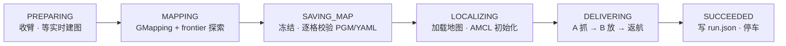

| 阶段 | 入口时刻 / s（仿真） | 阶段耗时 / s | 该阶段只做一件事 |
| :--- | ---: | ---: | :--- |
| `PREPARING` | 0.304 | 6.1 | 收回机械臂，等待实时建图可用 |
| `MAPPING` | 6.374 | 384.4 | 自动 frontier 探索，边探索边建图 |
| `SAVING_MAP` | 390.796 | 1.1 | 冻结地图快照并逐格核对 |
| `LOCALIZING` | 391.872 | 2.9 | 停建图、起 AMCL、静止校正 |
| `DELIVERING` | 394.820 | 248.9 | A 台抓取、B 台放置、返航 |
| `SUCCEEDED` | 643.748 | — | 终态验收并写盘 |

> 表中为仿真时间。交付段墙钟耗时 529.6 s，对应仿真实时率约 0.47——观测开销（截帧、录像）与物理仿真开销是分开的，验收动作不改变控制参数。

### 三处关键设计

**① 探索：把连续空间问题离散成有限候选集**

frontier 是已知空闲区与未知区的边界。实现不直接把边界质心当目标，而是按 stride 抽取至多 20 个边界点，在每个点周围取 3 个半径 {0.35, 0.55, 0.80} m × 16 个方向生成候选观察位，要求候选同时满足 `safe(p)`（在已知空闲区、满足机器人半径）与 `visible(p,f)`（到 frontier 的栅格连线不被障碍截断），并在 0.12 m 内去重。排序代价：

```text
S(p) = ‖p − r‖ + 0.5 · ‖p − f₀‖
       └─行驶成本─┘   └─离 frontier 过远的惩罚─┘
```

排序后的前 12 个候选还要逐个调用 `make_plan`，确认**当前地图上真的能走通**才提交 `move_base`。失败记忆以 0.35 m 邻域累计，同一 frontier 最多尝试两次；最小 frontier 尺寸 0.30 m，且要求边界点间最大几何跨度也 ≥ 0.30 m，避免小型未知斑块的弯曲边缘被反复选中。

终止判据不是"时间到了"，而是"**有效 frontier 耗尽，或只剩有界的小残余未知区域**"：与剩余边界相连的未知区按四邻域连通搜索，每块 ≤ 0.20 m²、合计 ≤ 0.30 m²，且不得延伸出搜索边界或地图边缘。这把"地图看起来差不多"变成了可复核的面积条件。

**② 交接：任何时刻只有一个 `map→odom` 发布者**

GMapping 运行时发布 `map→odom`，AMCL 启动后也发布同一条变换；两者重叠会让 TF 树出现两个父节点，导航与 RViz 都会变得不可解释。因此状态机把建图与定位**串行化**：先停车、冻结地图、逐格验证 PGM/YAML，再停止建图节点，最后加载地图并启动 AMCL。

AMCL 不是从零全局定位，而是用保存时的机器人位姿初始化粒子云，连续做 8 次静止更新，要求协方差对角项 ≤ 0.04、交接修正 ≤ 0.5 m / 0.5 rad。本次实测静止校正 0.666 s，最大位移 **0.000728 m**、最大航向漂移 **0.000136 rad**。

**③ 抓放：三层判据，任一层不过就拒绝**

| 层次 | 判据 | 失败行为 |
| :--- | :--- | :--- |
| 视觉对位 | 误差进入 \|e_d\| < 0.012 m、\|e_θ\| < 0.04 rad 后先发零速度，再连续稳定 0.25 s 才返回 | 继续对位；标记超 2.0 s 或丢帧超 3.0 s 则停车 |
| 夹爪反馈 | 闭合误差 ≤ 0.005 m、张开误差 ≤ 0.002 m、稳定 0.2 s | 抛 `Gripper feedback mismatch`，不调用抓取 |
| 几何包络 | 两指关节位置 ≤ 0.008 m **且**盒心与末端原点 3D 距离 ≤ 0.035 m | 拒绝附着，回报 `outside the 35 mm grasp envelope` |

抓取点由 ALVAR 标记与 Gazebo 模型状态共同确定：正常以标记为准；两者偏差超过 0.02 m 时改用模型状态。放置验收也不是"松手即成功"，而是释放后 5 s 内反复读取模型状态，要求平面误差 < 0.08 m、高度误差 < 0.025 m、线速度 < 0.03 m/s **同时成立**才记录 `placement_error`。

### 本轮结果

| 项目 | 本次结果 |
| :--- | :--- |
| 探索结束 | 仿真 382.878 s，`failures=0`，残余 0.25375 m²（0.1000 / 0.0844 / 0.0694 三块，均 < 0.20 m²） |
| 地图 | 352 × 672 栅格，分辨率 0.025 m，origin [-4.5, -3.5] |
| AMCL 静止检查 | 0.666 s，最大位移 0.000728 m，最大航向漂移 0.000136 rad |
| A 台对位 | −0.00716 m / 0.02788 rad（visual = true） |
| B 台对位 | 0.01172 m / 0.02089 rad（visual = false） |
| 抓取 | 成功，最大 FK 回代残差约 1.14 × 10⁻¹⁶ m |
| 放置误差 | 0.07858 m（容差 0.08 m，余量 1.42 mm） |
| 终态 | `HOLD`、`attached=False`、`cmd_vel` 全零；红盒在 B 台，机器人回到待命区 |
| 恢复动作 | 导航重试 1 次、导航/PID 交接 3 次，仍收敛到终态 |

<div align="center">


<sub>终态验收终端：status / control_mode / attached / cmd_vel / 物体与机器人位姿 / 对位与放置误差</sub>
</div>

### 现场记录

**运行总览**

<div align="center">

</div>

<p align="center"><sub>Gazebo 世界、RViz 地图与多传感器、YOLO 观察窗口、终端状态同屏</sub></p>

**建图：从空白到闭合**

<p align="center">
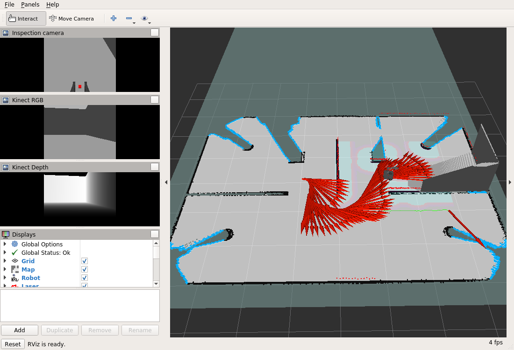

</p>
<p align="center">
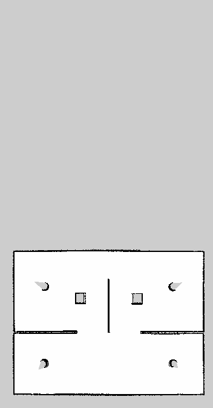

</p>

<p align="center"><sub>上排：建图中期与后期，墙体逐步闭合、激光束变长；下排：左为最终栅格地图，右为探索状态终端（frontier 递减、failures=0）</sub></p>

**抓取与放置**

<p align="center">

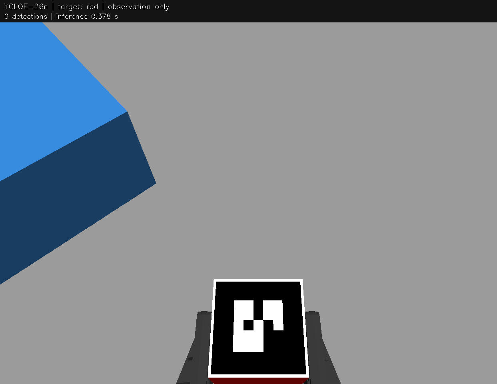
</p>
<p align="center">
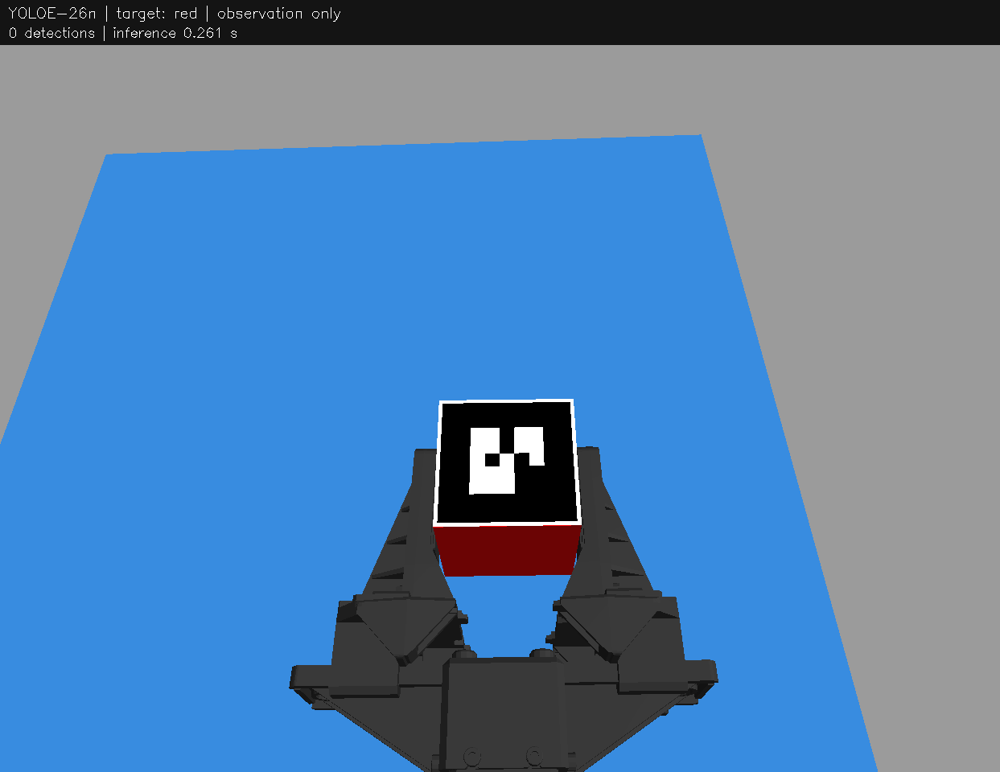

</p>

<p align="center"><sub>上：A 台同帧检出红/蓝/黄/绿四盒（目标色为红），红盒被夹持抬起；下：B 台释放、返航停车后的 RViz 地图</sub></p>

**动作序列联络表**（由 2 fps 录像抽帧合成，覆盖检测、对位、抓放、退离）

<p align="center">
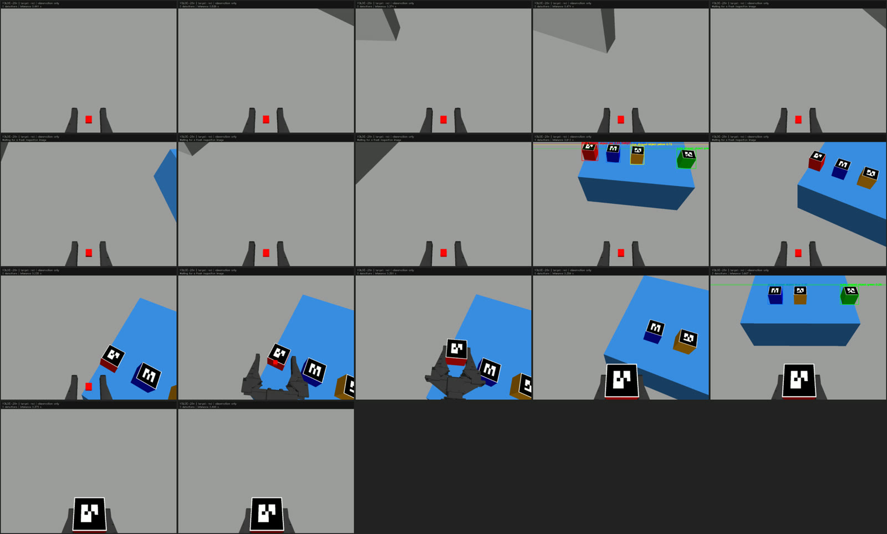

</p>

### 演示视频

上传前统一做 **2× 加速 + 核心片段截取**，并用 H.264（CRF 28）重编码，单段控制在 1 MB 量级。首屏动图是这些 MP4 的压缩预览；需要看完整片段时点封面——GitHub 的 README 会剥离 `<video>` 标签，仓库内的 MP4 无法内嵌播放，只能以链接形式打开。

<table>
<tr>
<td width="33%" align="center">
<a href="docs/media/video/mode2_1_pick.mp4">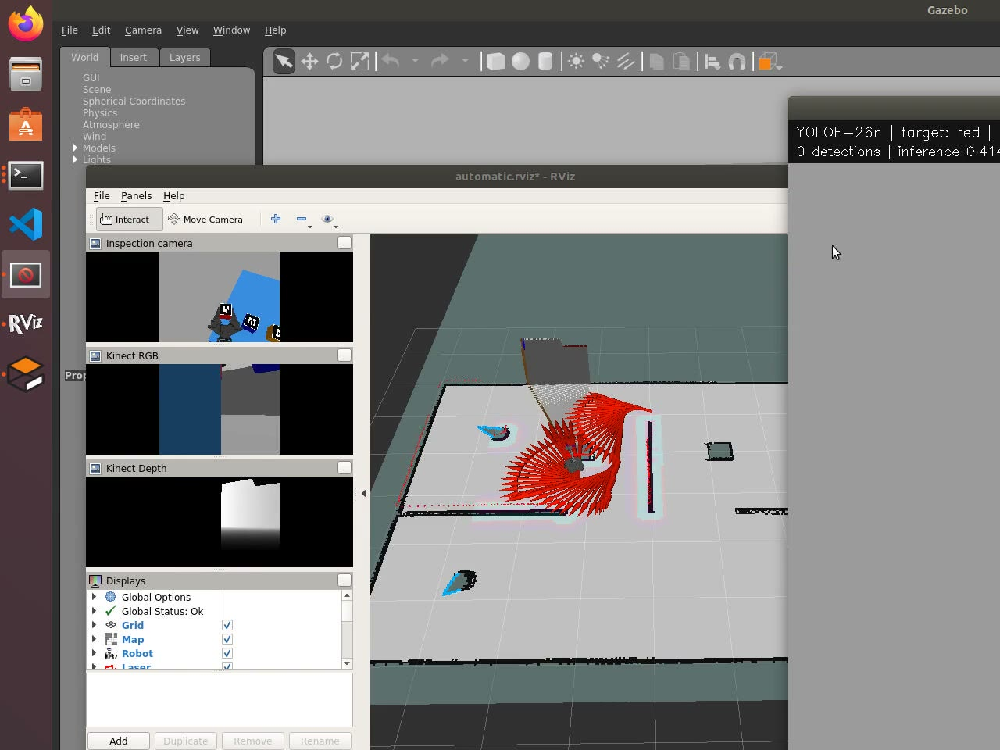</a>
<br><sub><b>A 台抓取</b><br>59 s · 2× 加速<br>对位 → 夹取 → 抬升</sub>
</td>
<td width="33%" align="center">
<a href="docs/media/video/mode2_1_place.mp4"></a>
<br><sub><b>B 台放置</b><br>62 s · 2× 加速<br>对位 → 下降 → 释放 → 退离</sub>
</td>
<td width="33%" align="center">
<a href="docs/media/video/mode2_1_mapping.mp4">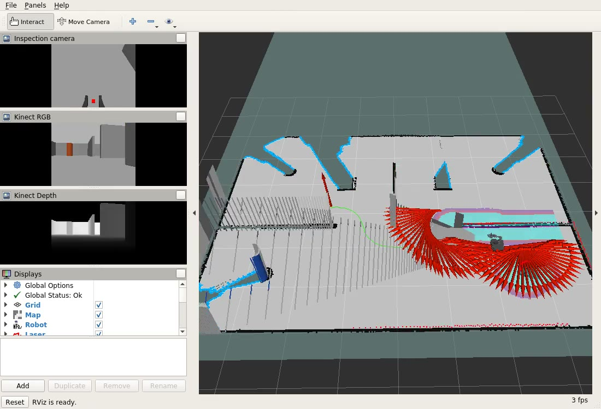</a>
<br><sub><b>建图延时</b><br>7 s · 2× 加速<br>frontier 探索地图生长</sub>
</td>
</tr>
</table>

### 一次典型失败与修复

第一轮 PICK 只回报了一句 `Object is outside the 35 mm grasp envelope`。表面看是抓取插件拒绝，实际是三个量在近距离叠加：ALVAR 近距斜视给出的标记点与 Gazebo 模型点相差约 **3.3 cm**，叠加 **1.2 cm** 的抓取高度偏移后，末端与盒心的 3D 距离略超 35 mm。

修复不是放宽容差，而是引入**一致性校正**：保留视觉对位，仅在标记点与模型点偏差超过 2 cm 时，用模型状态作为最终抓取点，并把触发条件与替换规则写进状态。

```text
Grasp target corrected: marker=(0.268, 0.007) model=(0.267, -0.025) error=0.033 m
```

<p align="center">
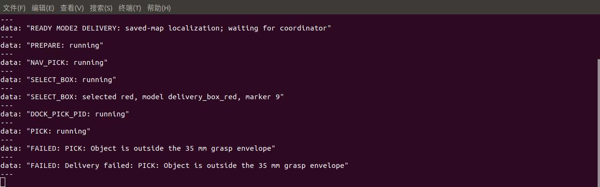

</p>

<p align="center"><sub>左：第一轮 35 mm 包络失败现场；右：模型一致性校正日志，随后 PICK / PLACE / RETURN_HOME 全部成功</sub></p>

### 复现

```bash
cd /home/jiayuexie/ROS
source /opt/ros/melodic/setup.bash
chmod +x src/final_project/scripts/*.py src/final_project/tools/render_robot.py
catkin_make -j2 -l2
source /home/jiayuexie/ROS/devel/setup.bash
roslaunch final_project simulation.launch mode:=2 target_color:=red
```

观察阶段与取消：

```bash
rostopic echo /final_project/status
rostopic echo /final_project/exploration/status
rosservice call /final_project/mode2/cancel '{}'
```

取消或失败后保持停车、已抓物体保留附着，不自动松爪；重新执行启动命令会清理旧现场并开始新任务。参数、话题与阶段细节见 [`final_project/README.md`](ROS/src/final_project/README.md)。

---

## 三、模式 2.2：视觉语言模型驱动的语义取物与可解释技能执行

> **模型只"提名"，不"动手"。** Qwen3-VL 在当前帧的候选编号里选一个，输出 `decision / candidate_id / summary`；坐标、速度、关节角不在它的输出空间里。ROS 端再核对颜色、帧龄、置信度排序、物理位置与 ALVAR 标记，然后复用模式 2.1 的视觉 PID、抓取约束、举示 2 s、原位放回与退离停车。

### 数据流

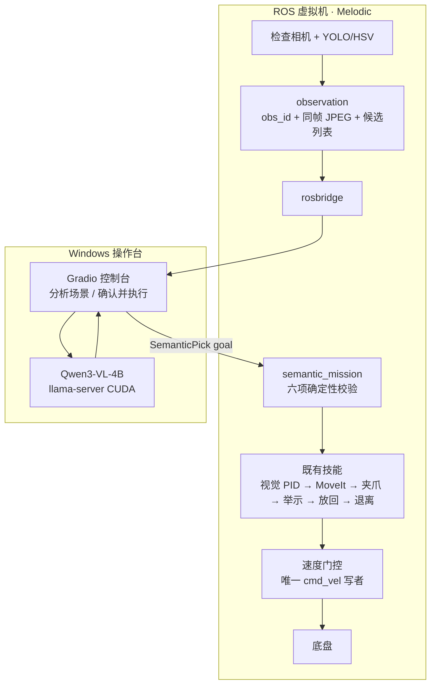

观察话题 `/final_project/embodied/observation` 以 **2.6–2.8 Hz** 发布；每个观察帧包含 `observation_id`、同帧 JPEG 和 YOLO 候选（`candidate_id`、颜色、标签、置信度、bbox）。动作目标必须引用**仍然有效**的观察帧。

### 受限决策：把开放生成压成闭集选择

| 约束项 | 取值 |
| :--- | :--- |
| 固定中文指令 | "拾取当前视野中 YOLO 检测置信度最高的目标盒子，完成举示动作后放回原位" |
| 模型输入 | 同帧带标注 JPEG + 候选列表 |
| 输出 schema | `decision ∈ {answer, pick_show_return, clarify}`、`candidate_id`、`summary` |
| 解码参数 | `temperature=0`、`max_tokens=256`、`response_format=json_schema` |
| 显式禁止 | 不生成坐标、速度、关节角 |

形式上，这是一个带约束的选择问题：给定候选集合 `C = {c₁ … cₙ}` 与同帧图像 `I`，模型输出 `d* = argmax_{c∈C} s(I, c)` 及决策标签。控制台还有防误触：没点"分析场景"就点"确认并执行"，界面返回"请先分析当前场景"，**不向 ROS 发送任何 goal**；即使已分析，执行前还要检查候选仍在当前快照中且是最高置信度。

### ROS 端六项校验

`semantic_mission` 在动作开始前做合取校验 `V = V_color ∧ V_age ∧ V_candidate ∧ V_argmax ∧ V_pose ∧ V_marker`，任一项为假即抛异常、Action 失败、保持停车：

| 校验 | 内容 | 失败含义 |
| :--- | :--- | :--- |
| `V_color` | 目标颜色必须在 `colored_boxes` 中 | 指令越界 |
| `V_age` | 在最近 256 条观察历史中找到该 `observation_id`，且距接收 ≤ 300 s | 用旧场景执行新命令 |
| `V_candidate` | `candidate_id` 存在且颜色与 goal 一致 | 候选串号 |
| `V_argmax` | 候选必须是该帧 YOLO 置信度最高者 | 模型选了非最优 |
| `V_pose` | 读取模型状态，确认盒子仍在 A 台期望位置 0.12 m 内 | 物体已被移动 |
| `V_marker` | 模型名与 ALVAR 标记绑定一致（黄 8 / 红 9 / 绿 10 / 蓝 11） | 物理身份不符 |

前四项只依赖观察历史与 goal，后两项才访问 Gazebo，检查按代价从低到高**短路**——这不是性能优化，而是安全逻辑：先用便宜条件排除明显无效的 goal，再用物理状态确认"这个东西现在真的在 A 台"。

### 三层安全边界

| 检查层 | 规则 | 失败结果 |
| :--- | :--- | :--- |
| Windows 控制台 | 必须先分析；候选仍存在；必须是最高置信度 | 拒绝执行，不发送 goal |
| ROS 语义节点 | observation ≤ 300 s；颜色一致；最高置信度；模型在 A 台 0.12 m 内 | Action 失败，保持停车 |
| 运行时 | Windows 心跳 ≤ 3 s；每个阶段检查取消 | `stop()`，零速度，取消机械臂/夹爪 |

心跳看门狗在取消检查里，超过 3 s 就停车；`SHOW` 阶段每 50 ms 检查一次，所以"举示 2 s"不是不可打断的黑盒。动作阶段为：

```text
VALIDATE_TARGET → PREPARE → DOCK_PICK_PID → PICK → SHOW（2 s） → PLACE（原位） → RETREAT（0.15 m） → SUCCEEDED
```

### 本轮结果

| 项目 | 本次结果 |
| :--- | :--- |
| 观察帧 | `obs_835`；该观察位同帧检出红/蓝/黄/绿四个候选 |
| 模型决策 | `pick_show_return`，`candidate_id = obj_1`（黄），置信度 0.2562 |
| 模型耗时 | 2.982 s（本地 4B 量化模型，CUDA） |
| 动作耗时 | 110.31 s，`success=true` |
| 终态 | `SUCCEEDED: Semantic pick/show/return completed`，`attached=False`，`mode=HOLD`，`cmd_vel` 全零 |
| 放回精度 | 黄盒 (−1.2012, 0.9154, 0.2050)，与原始 (−1.20, 0.90, 0.205) 平面偏差约 **0.0154 m** |
| 退离 | 0.150 m，与配置一致 |

<p align="center">


</p>

<p align="center"><sub>左：`decision=pick_show_return`、`candidate_id=obj_1`、置信度、推理耗时；右：同帧图像与结构化 JSON——没有任何坐标、速度或关节角</sub></p>

### 现场记录

**观察与拦截**

<p align="center">
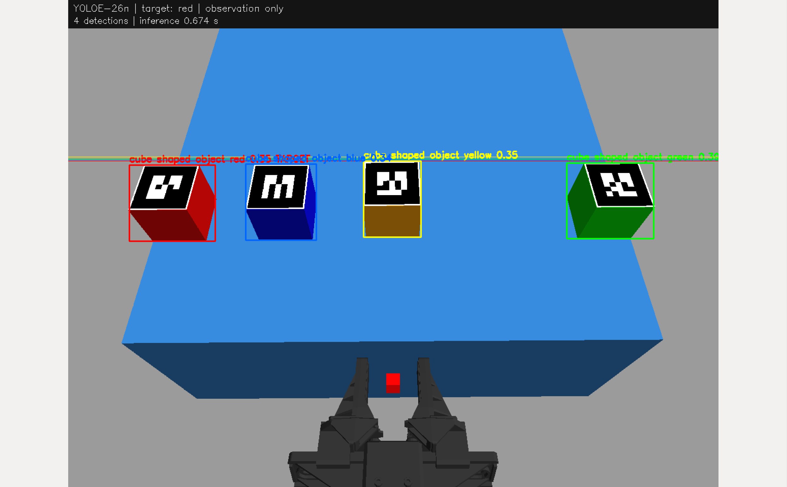

</p>

<p align="center"><sub>左：观察位同帧检出四个候选，"多候选择一"不是空话；右：未分析直接执行被拦截，阶段显示"未执行"</sub></p>

**执行链：对位 → 抓取 → 举示 → 放回 → 退离**

<p align="center">


</p>
<p align="center">

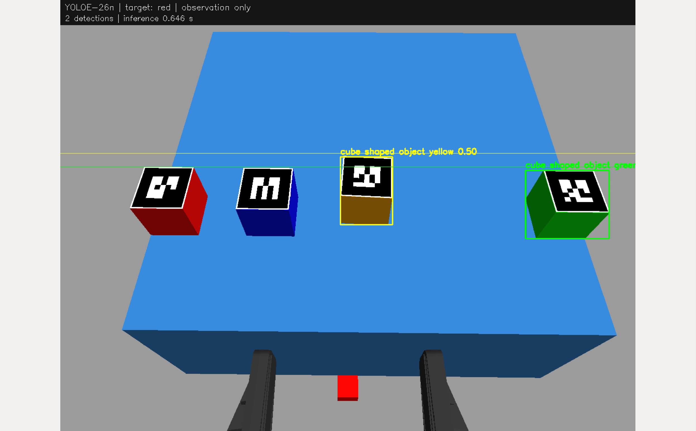
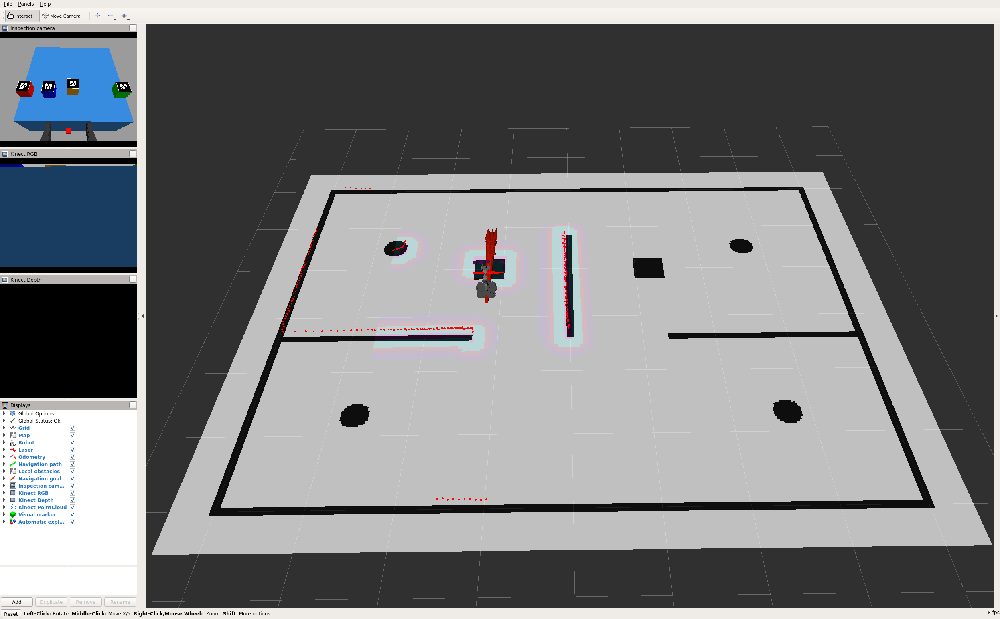
</p>

<p align="center"><sub>上：夹爪对准黄盒、抓取离台、举示保持 2 s；下：原位放回、YOLO 恢复检测、退离后终态</sub></p>

**终态验收**

<div align="center">

</div>

<p align="center"><sub>`SUCCEEDED` / `attached=False` / `HOLD` / 零速度，黄盒坐标与机器人退离位置同屏可核</sub></p>

### 演示视频

<table>
<tr>
<td width="60%" align="center">
<a href="docs/media/video/mode2_2_semantic_pick.mp4">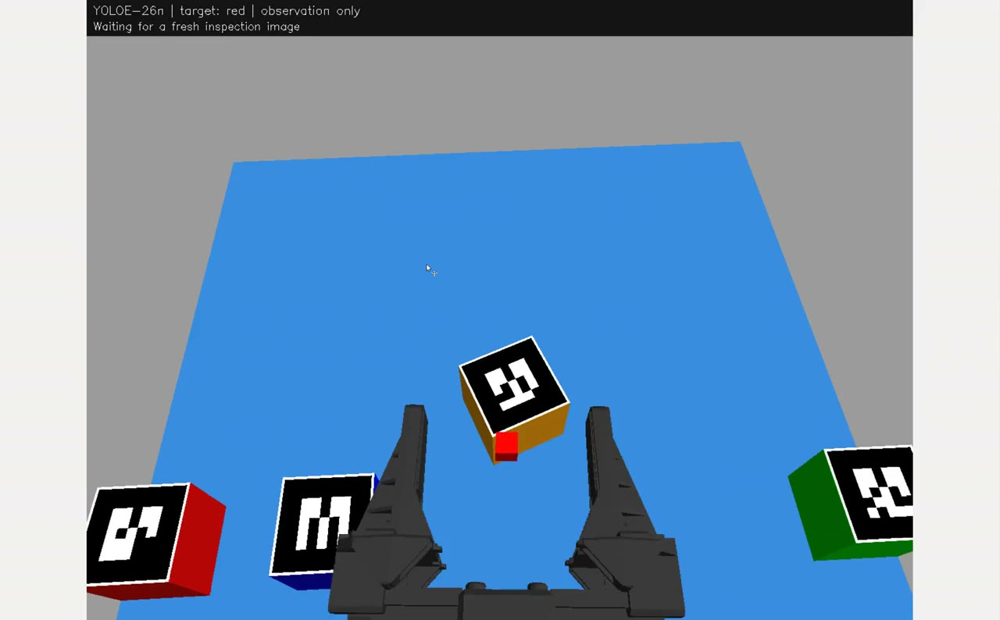</a>
<br><sub><b>语义取物全流程</b> · 66 s · 2× 加速<br>观察 → 受限决策 → 对位 → 抓取 → 举示 → 放回 → 退离</sub>
</td>
<td width="40%" align="left">
<b>看这段视频时值得注意三件事：</b><br><br>
① 机器人始终只做"选中的那一个目标"：四个候选同时存在，但只抓 `obj_1`；<br>
② 举示阶段有明确的 2 s 保持，随后是原位放回而不是随手丢下；<br>
③ 退离后 YOLO 重新检出四目标——证明物体确实离开了夹爪并稳定落在台面。
</td>
</tr>
</table>

### 复现

虚拟机侧（需先安装 `rosbridge_server` 并重新构建）：

```bash
cd /home/jiayuexie/ROS
source /opt/ros/melodic/setup.bash
catkin_make -j2 -l2
source /home/jiayuexie/ROS/devel/setup.bash
roslaunch final_project mode22.launch
```

Windows 侧先起本地模型服务，再起操作台：

```powershell
Start-Process -FilePath 'E:\Project\llama.cpp-b11836-win-cuda12\bin\llama-server.exe' -ArgumentList @(
  '-m','E:\Project\models\Qwen3-VL-4B-Instruct-GGUF\Qwen3VL-4B-Instruct-Q4_K_M.gguf',
  '--mmproj','E:\Project\models\Qwen3-VL-4B-Instruct-GGUF\mmproj-Qwen3VL-4B-Instruct-F16.gguf',
  '-c','4096','-np','1','--image-min-tokens','1024','-ngl','99','--host','127.0.0.1','--port','8080')

& 'E:\Programming\.conda\envs\mode22\python.exe' `
  'F:\University\Course\dasanshang\ROS_class\ROS\src\final_project\embodied\app.py' `
  --ros-host 192.168.162.132 --server-port 7860
```

> **注意**：`app.py` 与 README 的默认 `--ros-host` 是 `192.168.162.131`，本次实测虚拟机为 `.132`，运行时用参数覆盖。把这个差异写进记录，是为了避免把"连不上"误判成 ROS 节点故障。

---

## 四、基础任务与其余入口

| 模块 | 做了什么 | 验收结果 | 证据 |
| :--- | :--- | :--- | :--- |
| **task1** Hello ROS | 最小节点：初始化 → `loginfo` → 退出 | 输出一次 `Hello ROS!`，进程正常结束 | `docs/media/tasks/task1_hello_ros.png` |
| **task2** 通信机制 | `Student` 消息（4 字段）、`QueryStudent` 服务、1 Hz 话题、参数服务器 | 1 Hz 稳定；`found=true/false` 两路正确；学号前导零在消息/YAML/命令行三处同时保住 | `docs/media/tasks/task2_*.png` |
| **task3** TF2 + PID | 双广播器 + 相对位姿 + 双通道 PID（微分低通、条件积分、朝向限速、滞回停车） | 20 Hz 控制，终距 0.094–0.098 m，到达后不抖 | `docs/media/tasks/task3_follow_*.jpg` |
| **模式1** 键盘 | R 收臂解锁、W/S/A/D、T 速度档、1/2 站点、P/O 抓放、空格取消 | 全按键闭环；P/O 成功；空格同时清速度与取消动作 | `docs/media/mode1/*.png` |
| **模式3** 语音 | 讯飞流式听写 → 文本归一化 → 闭集解析 → 同一速度门控 | 四类指令接受；真实麦克风完成"状态→准备→微调前进→停止" | 见 `docs/RUNBOOK.md` 第 5 节 |

<p align="center">


</p>

<p align="center"><sub>左：`rostopic hz` 稳定 1 Hz；中：模式1 P 成功抬起箱体；右：双龟跟随的相对位姿与速度</sub></p>

<details>
<summary><b>为什么四种入口能共用一套底层？</b></summary>

底盘速度只有一个出口：`velocity_gate` 是 `/om_with_tb3/cmd_vel` 的唯一发布者，按模式在 `MANUAL / NAV / DOCK` 三种来源之间选择，模式不匹配即发零速度；手动命令缓存 0.3 s、导航/对位命令缓存 1.0 s，超时视为过期；线速度限幅 [−0.08, 0.18]、角速度限幅 [−0.7, 0.7]。最后一道独立边界是激光：运动方向 ±0.35 rad 内检测到障碍（前进 0.14 m / 后退 0.29 m）直接停车，扫描缺失或超 1.0 s 未更新也停车。

于是"安全"从"每个入口各自实现"变成"所有入口共用一个出口"——这也是模式1 的 R 互锁、模式2.2 的心跳停车、模式3 的 STOP 优先级可以并存而不互相打架的原因。

</details>

---

## 五、AUV 进阶实践（成果佐证）

> **声明：本目录仅收录比赛成果佐证材料，不包含 AUV 的任何源代码。** 该工程仍在用于后续比赛，代码、工程目录、模型权重与完整原始录像均未上传，`.gitignore` 中对此有显式拦截规则。

课程里的 ROS 通信、TF、PID、launch、状态机与录制方法，在真实水下机器人上从"能跑通"变成了"必须可信"：水下没有 GPS，池壁反光与水体浑浊会让视觉退化，正式比赛要求拔掉调试线自主运行。2026 年，这台自研 AUV 参加中国机器人大赛暨 RoboCup 机器人世界杯中国赛水下机器人赛项（水中巡游项目），在 5 m × 10 m 水池完成正式下水尝试。

<p align="center">


</p>

<p align="center"><sub>左：比赛水池中的前视画面（水体蓝绿，底部为 AUV 前部结构）；右：真实水下雷达帧的多墙 RANSAC 拟合</sub></p>

### 软件分层

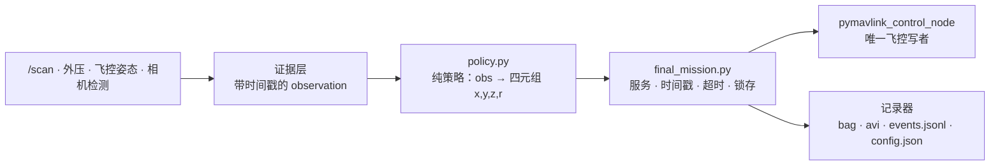

三条约束贯穿设计：**证据不创造目标**（缺失、歧义、过期即返回空，不用旧值补）、**唯一写者**（所有运动请求经 `MotionCommand` 进入同一飞控桥接）、**失败锁存**（压力/航向/飞控/记录/回执任一失效即 `ABORTED`，不自动重跑）。

### 关键结果

| 项目 | 条件 / 输入 | 结果 |
| :--- | :--- | :--- |
| 纯策略测试 | `test_final.py`，35 项 | **35/35 通过**，0.985 s |
| 状态机演示 | 确定性观测序列 | 28.7 s 到达 `DISARMING` |
| 赛场会话 981 | 1918 条状态，99.2 s，深度 −0.001–0.838 m | 完成下潜 → `FORWARD` → `BACK` → 最终停在 `LEFT` |
| 赛场会话 31be | 1082 条状态，57.4 s | 47.32 s 航向修正超时，锁存 `ABORTED` |
| 雷达墙检测 | 217c bag，850–862 s 窗口 | 稳定 1–3 面墙，最佳帧 0.459 / 1.054 / 2.445 m，RMS 7.3 / 7.9 / 13.0 mm |
| 球检测 | 217c 左目，141.5–147.0 s | 16 次 `blue_ball` 检测（置信度 0.38–0.84），**0 次通过门控** |

<p align="center">
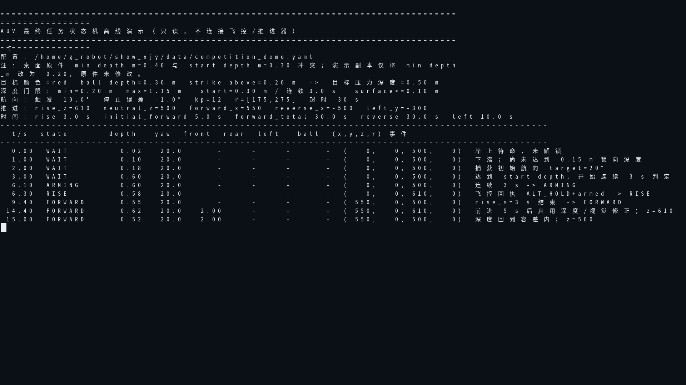
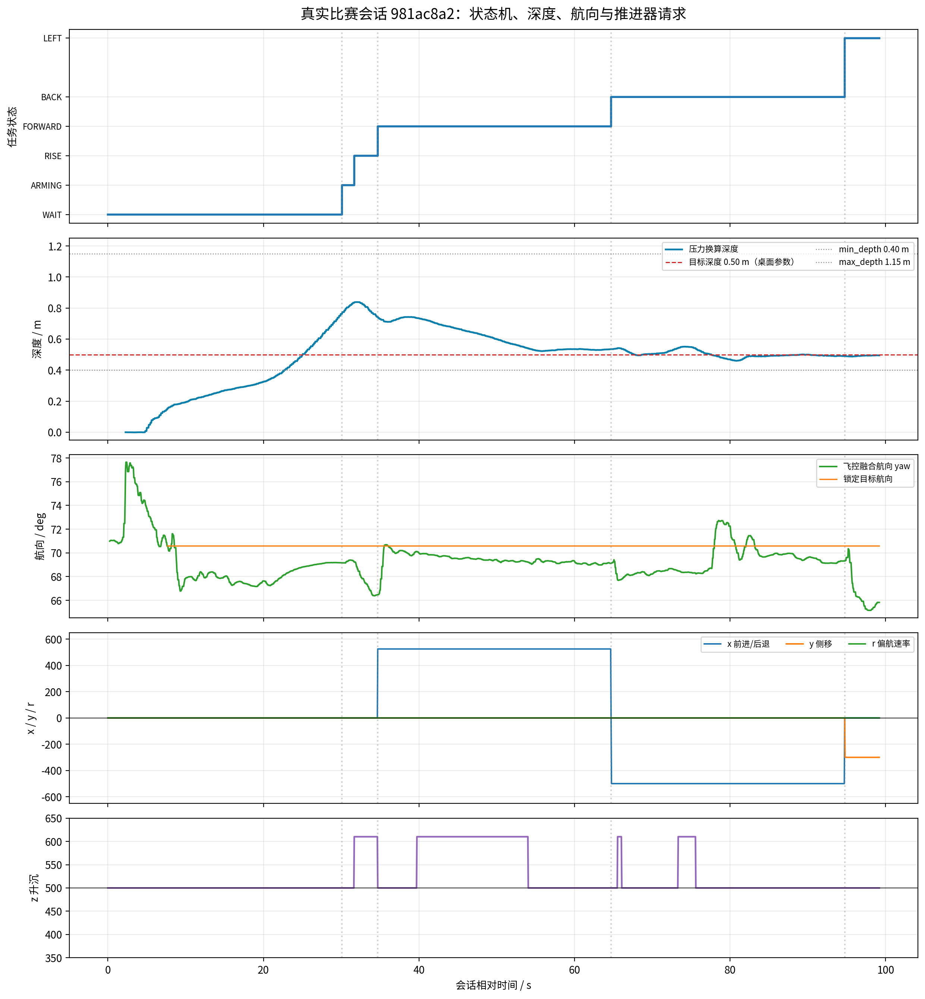
</p>

<p align="center"><sub>左：状态机确定性演示；右：真实赛场会话 981ac8a2 的状态、深度、航向与请求时间线</sub></p>

### 三条值得记录的发现

1. **有闭环不等于能收敛。** 31be 会话中目标航向约 70°，偏航速率请求从 −158 一路衰减到 −107，30 s 内误差始终没回到 −1°，适配层捕获超时后锁存中止。推进器推力、初始角速度、飞控限幅与水流都会让闭环失败。
2. **归一化宽高比是一个坐标系统陷阱。** 16:9 画面中归一化宽高比等于像素宽高比乘以 0.5625；真实蓝球的归一化宽高比为 0.306–0.425，全部被 0.5–2.0 的门控拒绝，`ball_x` 始终为空。问题不在"模型没检出"，而在"检测框进入策略的几何条件写错了坐标系"。
3. **"未确认"必须写进日志。** 前进结束记 `impact unconfirmed`、后退结束记 `rear contact unconfirmed`、左移结束记 `return unconfirmed`——定时到、近墙或球消失都不等于撞球成功。

### 佐证材料索引

| 目录 | 内容 | 数量 |
| :--- | :--- | :--- |
| `AUV/figures/` | 架构图、任务时间线、航向中止、雷达三面墙拟合、球门控诊断 | 5 张 |
| `AUV/screenshots/` | 环境、工程结构、单元测试、状态机、墙检测、球检测、赛场 | 13 张 |
| `AUV/videos/` | 入水与下潜、状态机终端演示、雷达墙检测动画、蓝球检测标注、比赛水下片段 | 5 段 |
| `AUV/logs/` | 单元测试、状态机、真实会话摘要、墙/球检测、环境核验 | 25 份 |
| `AUV/data/` | 会话 CSV、雷达 JSONL、检测 CSV、演示参数副本 | 7 份 |
| `AUV/AUV_Project_Summary.md` | 完整文字版：算法、实验、图表索引、复现路径 | 1 篇 |

<p align="center">
<a href="AUV/videos/05_pool_launch_and_dive.mp4">▶ 入水与下潜（35 s）</a> ·
<a href="AUV/videos/04_competition_pool.mp4">▶ 比赛水下片段</a> ·
<a href="AUV/videos/02_lidar_wall_detection.mp4">▶ 雷达墙检测</a> ·
<a href="AUV/videos/03_ball_detection_annotated.mp4">▶ 蓝球检测标注</a> ·
<a href="AUV/videos/01_mission_state_machine.mp4">▶ 状态机演示</a>
</p>

---

## 六、复现与验证

**环境准备**（每个新终端）：

```bash
export LANG=C.UTF-8
export LC_ALL=C.UTF-8
export PYTHONIOENCODING=utf-8
source /opt/ros/melodic/setup.bash
source ~/ROS/devel/setup.bash
```

**构建**：

```bash
cd ~/ROS
catkin_make -j2 -l2
```

**四个入口**：

| 入口 | 启动命令 |
| :--- | :--- |
| 模式 1 键盘 | `roslaunch final_project simulation.launch mode:=1` 然后 `rosrun final_project keyboard_control.py` |
| 模式 2.1 全自动 | `roslaunch final_project simulation.launch mode:=2 target_color:=red` |
| 模式 2.2 语义 | `roslaunch final_project mode22.launch` + Windows 操作台 |
| 模式 3 语音 | `roslaunch final_project simulation.launch mode:=3` |

逐条命令、按键语义、话题与服务清单见 [`docs/RUNBOOK.md`](docs/RUNBOOK.md)；逐轮部署、失败与修复记录见 [`ROS/src/final_project/VALIDATION.md`](ROS/src/final_project/VALIDATION.md)。

> 本仓库所有数值都来自**单次完整运行**的日志与 `run.json`，不用于推断成功率。抓取与放置验收使用 Gazebo 模型状态，适合仿真，不等于真实传感器精度。

---

## 七、仓库说明

### 收录范围

| 已收录 | 说明 |
| :--- | :--- |
| `ROS/src/**` | task1、task2、task3、final_project 全部源码、launch、config、URDF、地图与 ONNX 权重 |
| `docs/media/**` | 模式 2.1 / 2.2 / 模式1 / task1–3 的截图与经加速裁剪的演示视频 |
| `AUV/**` | 图表、截图、日志、数据与 4 段演示视频（**仅佐证材料**） |

| 未收录 | 原因 |
| :--- | :--- |
| AUV 源代码（`Jetson_core_code/`、`tools/`、`ros_home/`） | 后续比赛在研项目，禁止公开 |
| AUV 原始录像与完整媒体库（约 878 MB） | 体积过大，且含未脱敏现场信息 |
| 课程报告 docx | 含姓名、学号等个人信息 |
| catkin `build/`、`devel/`、`logs/`、`backups/` | 构建产物与历史快照，不含源信息 |

### 第三方复用与许可

工程内自研部分为手动 Action、模式接入、控制权切换、运动学校验、条件约束抓取插件，以及模式 2 的探索适配与"地图—定位—取送"顺序协调。复用部分保留原始许可：

- `urdf/upstream/*.xacro`、`config/robot.srdf`、ALVAR 标记贴图：ROBOTIS，Apache-2.0
- `src/third_party/explore_lite/`：`hrnr/m-explore`，BSD 三条款（含 Bosch / Jiri Horner 版权）
- `vision/`：Ultralytics YOLOE 导出链路，AGPL-3.0（许可证随目录提供）
- GMapping、AMCL、move_base、MoveIt、ros_control、Gazebo：ROS Melodic 发行包
- 模式 2.2：Qwen3-VL-4B-Instruct-GGUF、llama.cpp、rosbridge_suite、roslibpy、Gradio

完整清单见 [`ROS/src/final_project/THIRD_PARTY.md`](ROS/src/final_project/THIRD_PARTY.md)。

### 已知限制

- 模式 2.1 结果来自一次完整运行，仍对定位敏感；B 台放置误差 0.07858 m 已接近 0.08 m 容差，说明释放接触与台面滑动尚未建模。
- 模式 2.2 只验证了单次语义取物，未覆盖反向任务、连续多次任务、动态障碍与真实硬件；Qwen 推理 2.982 s 与 3 s 心跳共同决定了这套演示的节奏。
- 模式 3 的完整语音搬运与运动中语音停车尚未验收；云端识别存在延迟，精对位仍依赖微调指令。
- AUV 部分为"真实链路已跑通、完整任务未完成"的如实记录，不宣称赛项满分。

---

<div align="center">
<sub>本项目为《Linux 基础及 ROS 应用实践》课程作业 · 仅收录课程成果与脱敏后的比赛佐证材料</sub>
<br>
<sub>如果这个仓库对你有帮助，欢迎 star ⭐</sub>
</div>
